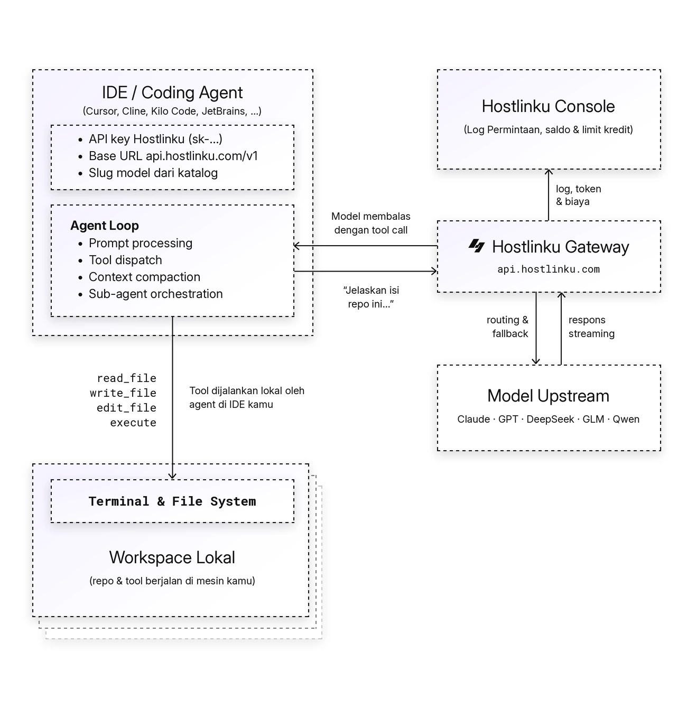

import { Callout, Steps } from "/snippets/mdx.jsx";

The [OpenAI Agents SDK](https://openai.github.io/openai-agents-python/) uses the **Responses API** by default, which is provided by Hostlinku at [`POST /v1/responses`](/en/responses). Simply provide the OpenAI client with Hostlinku’s `base_url`, and disable tracing (tracing is exported to the OpenAI platform, not through the gateway).

<Callout type="note" title="Model and tool compatibility">
  Choose a model available in the API key Service Mode. Vision, JSON schema, reasoning, and tool calling depend on the model and protocol path. See [compatibility limits](/en/responses).
</Callout>

<Steps>


### Install

```bash
pip install openai-agents            # Python
npm install @openai/agents openai    # TypeScript / Node.js
```

### Python

```python
import os
from openai import AsyncOpenAI
from agents import Agent, Runner, function_tool, set_default_openai_client, set_tracing_disabled

client = AsyncOpenAI(
    base_url="https://api.hostlinku.com/v1",
    api_key=os.environ["HOSTLINKU_API_KEY"],
)
set_default_openai_client(client, use_for_tracing=False)
set_tracing_disabled(True)


@function_tool
def cuaca(kota: str) -> str:
    """Cuaca saat ini di sebuah kota."""
    return f"Cuaca di {kota}: cerah, 31°C"


agent = Agent(
    name="Asisten",
    instructions="Jawab singkat dalam bahasa Indonesia.",
    model="claude-sonnet-4-6",
    tools=[cuaca],
)

result = Runner.run_sync(agent, "Bagaimana cuaca di Jakarta hari ini?")
print(result.final_output)
```

### TypeScript

```ts
import OpenAI from "openai";
import { Agent, run, tool, setDefaultOpenAIClient, setTracingDisabled } from "@openai/agents";
import { z } from "zod";

setDefaultOpenAIClient(
  new OpenAI({ baseURL: "https://api.hostlinku.com/v1", apiKey: process.env.HOSTLINKU_API_KEY })
);
setTracingDisabled(true);

const cuaca = tool({
  name: "cuaca",
  description: "Cuaca saat ini di sebuah kota",
  parameters: z.object({ kota: z.string() }),
  execute: async ({ kota }) => `Cuaca di ${kota}: cerah, 31°C`,
});

const agent = new Agent({
  name: "Asisten",
  instructions: "Jawab singkat dalam bahasa Indonesia.",
  model: "gpt-5-5",
  tools: [cuaca],
});

const result = await run(agent, "Bagaimana cuaca di Jakarta hari ini?");
console.log(result.finalOutput);
```

### Verification

If the model calls a tool, this example usually creates two requests in **Request Logs**: the tool-call turn and the answer turn.

</Steps>

## How the agent loop works

The agent sends a prompt to the gateway. When the model requests a tool, the SDK runs it and sends the result back until the answer is complete. Each model call has its own request in **Request Logs**.



## Without changing the code: environment variable

The OpenAI SDK reads `OPENAI_BASE_URL` and `OPENAI_API_KEY`, so the Agents SDK can be directed to Hostlinku without modifying the code-just disable tracing via the environment variables as well:

```bash
export OPENAI_BASE_URL=https://api.hostlinku.com/v1
export OPENAI_API_KEY=sk-your-api-key          # API key Hostlinku
export OPENAI_AGENTS_DISABLE_TRACING=1
python agent.py
```

## Responses API or Chat Completions?

The SDK defaults to Responses API (`/v1/responses`). Reasoning and tool support depend on the model and native/bridge path. To use Chat Completions (`/v1/chat/completions`):

```python
from agents import set_default_openai_api
set_default_openai_api("chat_completions")
```

```ts
import { setOpenAIAPI } from "@openai/agents";
setOpenAIAPI("chat_completions");
```

Both use the same API key, balance, and request logs.

<Callout type="important" title="Stateless: Do not use previous_response_id / conversation">
Hostlinku does not store responses. Let `Runner`/`run` manage the history (by default, the SDK sends the entire history in `input` on each turn). Do not set `previous_response_id`, `conversation_id`, or `OpenAIConversationsSession`-the gateway will reject them with a `400 invalid_request_error`. Local sessions such as `SQLiteSession` can still be used because the history is stored on your end.
</Callout>

## Supported via the gateway

| Agents SDK Features | Status |
|---|---|
| `function_tool` / `tool()`, parallel tool calls | Available on models supporting function calling; parallel calls depend on the model. |
| Handoffs between agents (including different models per agent) | Yes - mix `claude-sonnet-4-6` and `gpt-5-5` in a single workflow |
| Structured output (`output_type` / Zod) | Yes, for models that support JSON schema |
| Streaming (`Runner.run_streamed`, `run(..., { stream: true })`) | Yes |
| `reasoning={"effort": …}` via `ModelSettings` | Accepted; supported values and results depend on the model and protocol path. |
| OpenAI hosted tools (`WebSearchTool`, `FileSearchTool`, `CodeInterpreterTool`) | Depends on upstream native Responses support; the chat bridge only translates `type: "function"` tools. Implement a function tool when a hosted tool is unavailable. |
| Tracing to the OpenAI platform | Not via the gateway - disable it, or use a third-party trace processor |

## Troubleshooting

- **Full error log *tracing export 401*** - tracing has not been disabled; call
`set_tracing_disabled(True)` / `setTracingDisabled(true)` or set `OPENAI_AGENTS_DISABLE_TRACING=1`.
- **`400 previous_response_id is not supported`** - remove the use of `previous_response_id` /
`conversation_id`; see the callout above.
- **`404 model_not_found`** - `model=` must be the Hostlinku slug, not the original OpenAI/Anthropic model name.
