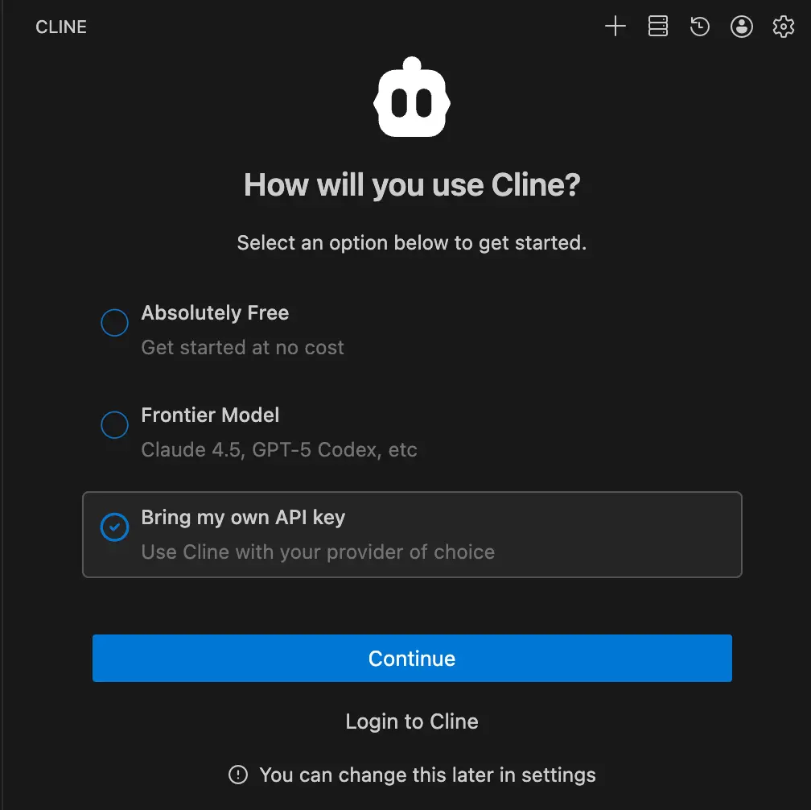
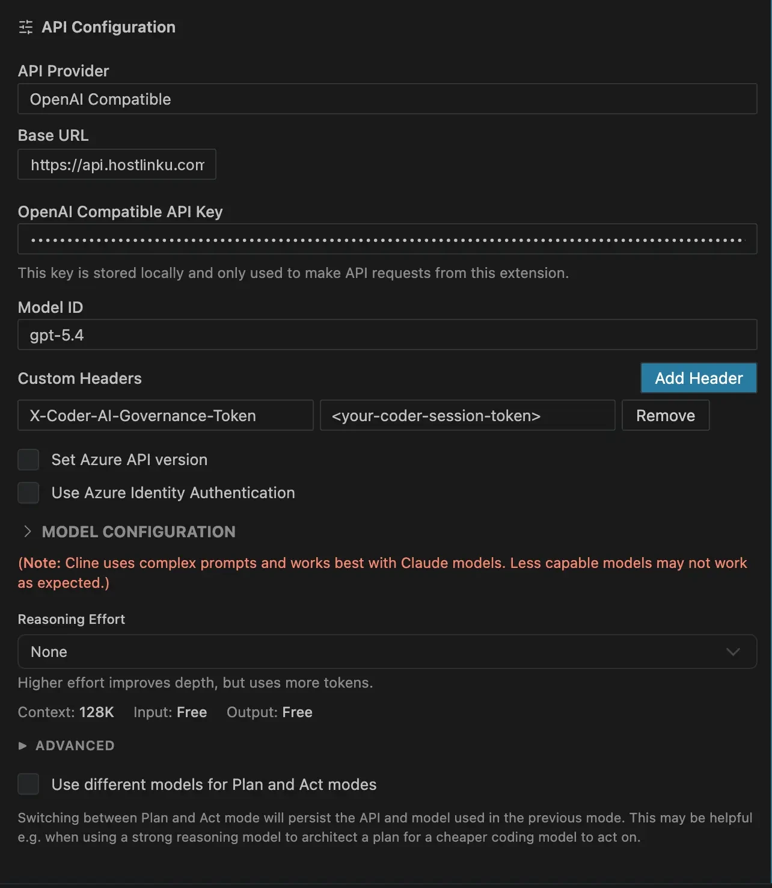
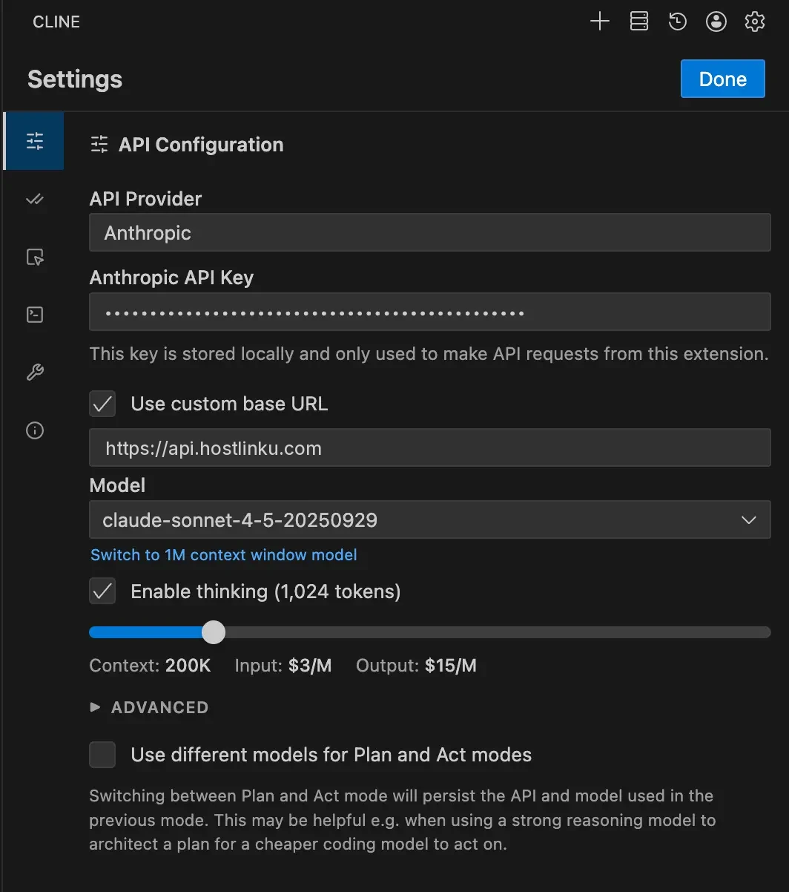

import { Callout, Steps } from "/snippets/mdx.jsx";

[Cline](https://cline.bot) — along with its fork **Roo Code** — provides
an **OpenAI Compatible** provider that accepts a base URL, API key, and any model ID. That is the
simplest route for Hostlinku; an alternative route via the **Anthropic** provider is discussed below.
Using **Kilo Code**? See the specific guide at [Kilo Code](/en/integrations/kilo-code).

<Steps>

<a id="buka-pengaturan-provider"></a>

<a id="open-the-carrier-settings"></a>

### Open provider settings

In the Cline panel, click the gear icon (**Settings**) → **API Configuration**.

When Cline first opens, it displays the *How will you use Cline?* screen—select **Bring my
own API key**, then **Continue**.



<a id="pilih-openai-compatible-dan-isi"></a>

<a id="select-openai-compatible-and-fill-in-the-fields"></a>

### Select "OpenAI Compatible" and fill in

| Field | Value |
|---|---|
| **API Provider** | `OpenAI Compatible` |
| **Base URL** | `https://api.hostlinku.com/v1` |
| **API Key** | `sk-…` (Hostlinku API key) |
| **Model ID** | slug from [catalog](/en/models), e.g., `claude-sonnet-4-6` |

.")

<a id="disarankan-lengkapi-model-configuration"></a>

<a id="recommended-complete-the-configuration-model"></a>

### (Recommended) Complete the Model Configuration

Open the **Model Configuration** section so that Cline can manage context and pricing correctly:

- **Supports Images**: check this box for vision models (`claude-sonnet-4-6`, `gpt-5-5`).
- **Context Window Size**: `context_window` from the catalog (e.g., `1000000`).
- **Max Output Tokens**: Follow the model’s output limit in the [catalog](/en/models). `64000` is just an example; use a smaller value if the model’s limit is lower.
- **Input / Output Price**: copy from the `pricing` catalog if you want an accurate estimate of Cline costs;
  the actual billing remains as recorded in the console.



<a id="verifikasi"></a>

### Verification

Click **Done**, submit a small task (*"summarize this repo’s README"*). The request appears in the console →
**Request Log**.

</Steps>

<a id="mode-plan--act-dengan-model-berbeda"></a>

<a id="planact-mode-with-different-models"></a>

## Plan/Act mode with a different model

Cline can use different models for the **Plan** and **Act** modes. Common cost-effective combinations:
**Plan** = `claude-opus-4-6` or `gpt-5-5` (reasoning), **Act** = `claude-sonnet-4-6` or
`deepseek-v4-flash` (execution). Enable *"Use different models for Plan and Act modes"* in
the settings, then enter the same provider profile with different model IDs.

<a id="alternatif-provider-anthropic"></a>

<a id="alternative-anthropic"></a>

## Alternative: provider Anthropic

Cline also has the **Anthropic** provider with the *Use custom base URL* option. Enter
`https://api.hostlinku.com` (without `/v1`) and your Hostlink API key. The difference: the list of models on
this provider is **limited to IDs recognized by Cline**—select a Claude model whose slug matches
Hostlinku’s catalog (e.g., `claude-sonnet-4-6`, `claude-haiku-4-5`). For non-Claude models or slugs
not listed, use **OpenAI Compatible**.



<Callout type="note" title="Prompt caching">
  Via the Anthropic route, Cline sends `cache_control` and Hostlinku forwards it—the cache token
  is reported in `cache_read_input_tokens` and billed at the model cache rate. Via the OpenAI
  Compatible route, caching is handled automatically by models that support it.
</Callout>

## Cline CLI

```bash
cline auth -p openai -k "$HOSTLINKU_API_KEY" -b https://api.hostlinku.com/v1
cline --model claude-sonnet-4-6 "tambahkan validasi input di handler login"
```

## Troubleshooting

- **`401`** - invalid or revoked key. In Roo Code, ensure the key is entered in the **profile** of the currently
  active provider, not in another profile.
- **`404 model_not_found`** - Incorrectly typed model ID; copied from `GET /v1/models`.
- **`404` in all requests** - the base URL is missing `/v1` (OpenAI path) or, conversely, uses `/v1` in the
  Anthropic path. Compare with the screenshot above.
- **Empty response in Act mode** - check *tool calling* support for the model in the [catalog](/en/models).
- **Context runs out quickly** - set the *Context Window Size* according to the catalog so that Cline trims the history
  correctly.
