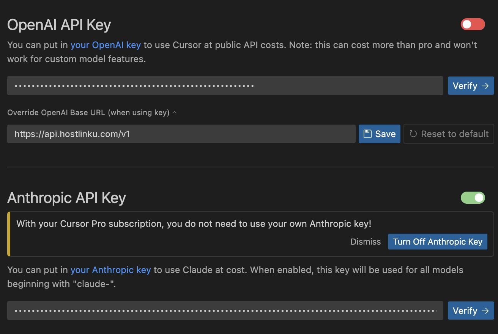

import { Callout, Steps } from "/snippets/mdx.jsx";

[Cursor](https://cursor.com) allows you to use your own API key via *Override OpenAI Base URL*.
By pointing it to Hostlinku, chat, Cmd-K (inline edit), and Agent use models from
the Hostlinku catalog and are charged to your balance, not your Cursor quota.

<Steps>

<a id="buka-pengaturan-model"></a>

### Open model settings

`Cursor Settings` (⌘/Ctrl + Shift + J) → **Models** tab.

<a id="isi-api-key-dan-base-url"></a>

<a id="enter-the-api-key-and-base-url"></a>

### Fill in the API key and base URL

In the **API Keys** section:

1. Enable the **OpenAI API Key** and paste your Hostlinku API key (`sk-…`).
2. Enable **Override OpenAI Base URL** and enter:

```text
https://api.hostlinku.com/v1
```



Do not add `/chat/completions` at the end—Cursor adds the path itself. Click
**Save**, then **Verify** next to the API key field; Cursor sends a test request to the gateway.

<a id="tambahkan-model-hostlinku"></a>

<a id="add-a-hostlinku-model"></a>

### Add the Hostlinku model

Still on the **Models** → **Add Custom Model** tab, enter the exact slugs from the
[catalog](/en/models), one by one:

```text
claude-sonnet-4-6
gpt-5-5
deepseek-v4-flash
```

Disable any built-in models you don’t want to use to keep the model selection list concise.

<a id="pilih-model-di-chat"></a>

### Select a model in the chat

In the Chat/Agent panel, select the newly added model from the model dropdown. The first request will
appear in the console → **Request Log**.

</Steps>

<a id="yang-perlu-diketahui"></a>

## What You Need to Know

<Callout type="warning" title="&quot;Override&quot; is a global term">
  While **Override OpenAI Base URL** is enabled, all OpenAI family models in Cursor—including those
  managed by Cursor—are redirected to Hostlinku. Use the Hostlinku slug for everything, or disable
  the override toggle when you want to return to Cursor’s default models.
</Callout>

- **Requests are sent from the Cursor server**, not from your computer. Therefore, the base URL must be
  public—`https://api.hostlinku.com` meets this requirement (`localhost` addresses are rejected by Cursor).
- **The Cursor Tab (autocomplete) is not affected.** The Tab feature uses Cursor’s proprietary infrastructure and
  cannot be migrated to any other provider. Hostlinku supports chat, Cmd-K, and Agent.
- **Agent mode** requires *tool calling* and *streaming*. Check for support in the [catalog](/en/models). If *BAD_MODEL_NAME* appears, check the slug and ensure the **OpenAI API Key** toggle is enabled.
- **Connection hangs / protocol error** - in the same settings, change *HTTP Compatibility
  Mode* to **HTTP/1.1**.

<Callout type="tip" title="Claude model via the OpenAI channel">
  You do not need to fill in the *Anthropic API Key* field. The slug `claude-sonnet-4-6` is invoked via the same
  OpenAI Chat Completions endpoint; the gateway translates it to the Anthropic protocol.
</Callout>

## Troubleshooting

| Symptoms | Solution |
|---|---|
| *Verify* failed `401` | The API key is incorrect or has been revoked, or spaces were accidentally copied along with it. |
| *Model not found* | The "slug" is a typo—copy it from `GET /v1/models`. |
| Answer truncated | The model has a smaller output limit than what the Cursor requested; try a different model or Service Mode. |
| The agent stops midway with `429` | The agent sends multiple parallel requests. See [Usage & Limits](/en/usage-and-limits). |
