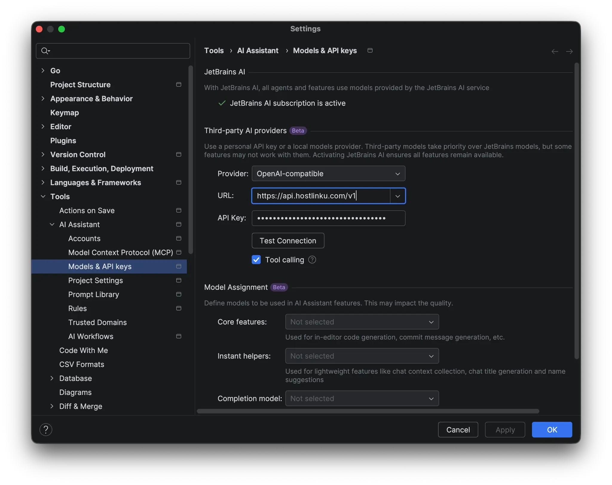
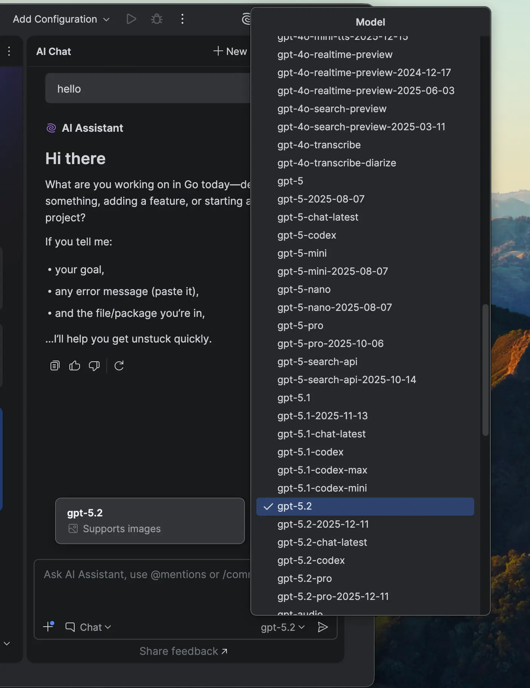

import { Callout, Steps } from "/snippets/mdx.jsx";

[JetBrains AI Assistant](https://www.jetbrains.com/help/ai-assistant/) supports **third-party AI
providers**: you can direct AI Chat to any *OpenAI-compatible* endpoint using your own API key
. By entering it into Hostlinku, chats in IntelliJ IDEA, PyCharm, WebStorm, GoLand, Rider,
and other JetBrains IDEs use models from the Hostlinku catalog and are charged to your balance.

**Prerequisites:** The **AI Assistant** plugin must be installed and active, and you must have a Hostlinku API key (`sk-…`) from
[console](https://console.hostlinku.com) → **API Keys**.

<Steps>

### Open model settings

**Settings** (⌘ + , / Ctrl + Alt + S) → **Tools** → **AI Assistant** → **Models & API keys**.

### Add Hostlinku as a third-party provider

In the **Third-party AI providers** section:

| Field | Value |
|---|---|
| **Provider** | `OpenAI-compatible` |
| **URL** | `https://api.hostlinku.com/v1` |
| **API Key** | `sk-…` (Hostlinku API key) |
| **Tool calling** | checked |

Click **Test Connection**—the IDE sends a test request to the gateway. If successful, click **Apply**
then **OK**.

### (Optional) Set Model Assignment

In the **Model Assignment** section, you can select a Hostlinku model for **Core features** (e.g.,
`claude-sonnet-4-6`) and **Instant helpers** (e.g., `claude-haiku-4-5`). Leave the **Completion model**
set to *Not selected*—inline autocomplete uses FIM, which is not supported by Hostlinku (see
[Overview](/integrations#compatibility-limits)).

### Select a model in AI Chat

Open **AI Chat**, ensure **Chat** mode is active, then select a model from the model dropdown. The list
is retrieved from `GET /v1/models`, so the displayed slugs match those in the [catalog](/en/models).

The first request will appear in the console → **Request Log**.

</Steps>

## What You Need to Know

<Callout type="note" title="Only OpenAI-compatible paths">
  The AI Assistant currently only supports *OpenAI-compatible* providers for third-party services—there is no
  Anthropic base URL option yet. The Claude model can still be used: the `claude-sonnet-4-6` slug is invoked via
  Chat Completions and a gateway that translates to the Anthropic protocol.
</Callout>

- **The Base URL must end with `/v1`.** The IDE adds `/models` and `/chat/completions` on its own;
  without `/v1`, *Test Connection* fails with a `404`.
- **No custom headers.** The AI Assistant only sends the API key as
  `Authorization: Bearer sk-…`—that is sufficient for Hostlinku.
- **Tool calling in the IDE** requires a model that supports it. Check the [catalog](/en/models) and check **Tool calling** in the model settings.
- **Claude Code on JetBrains** is a separate integration (the Claude Code plugin uses its own CLI). See
  [Claude Code](/en/integrations/claude-code).

## Troubleshooting

| Symptoms | Solution |
|---|---|
| *Test Connection* failed `401` | The API key is incorrect or has been revoked, or spaces were accidentally copied along with it. |
| *Test Connection* failed `404` | URLs do not end with `/v1`, or there are additional paths such as `/chat/completions`. |
| Empty dropdown model | The connection has not been *Applied*, or the API key does not have access to any models in its Service Mode. |
| Chat stops with `429` | Too many parallel requests. See [Usage & Limits](/en/usage-and-limits). |
