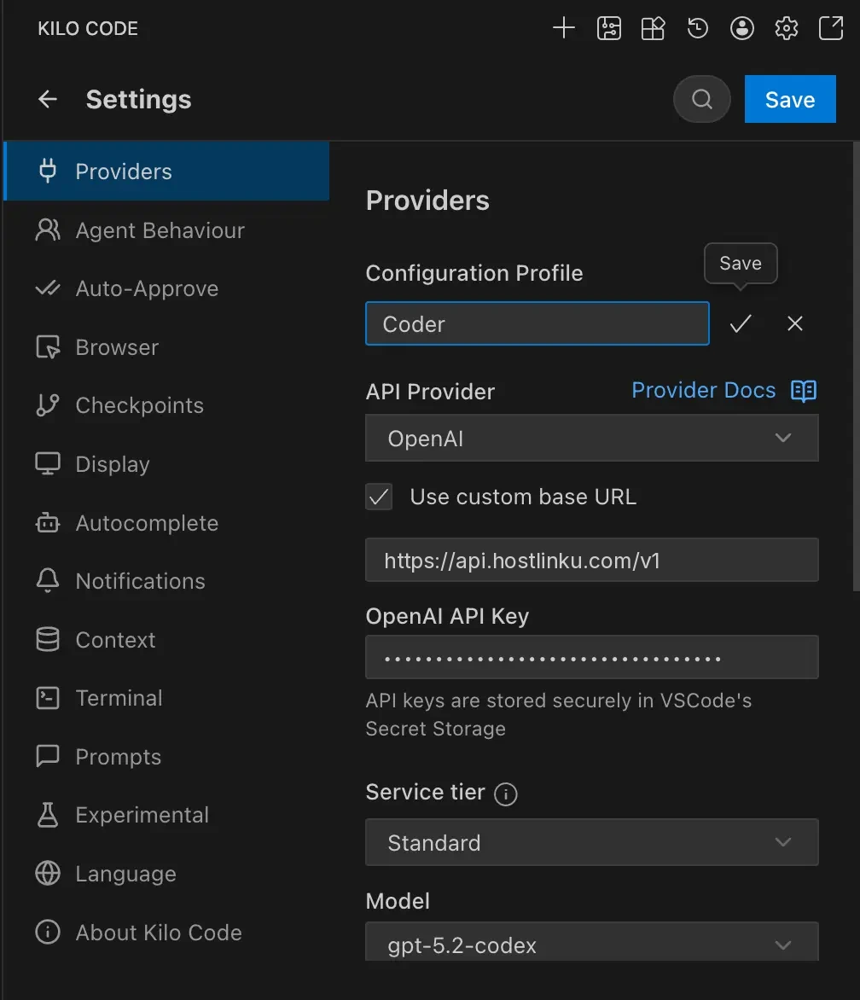
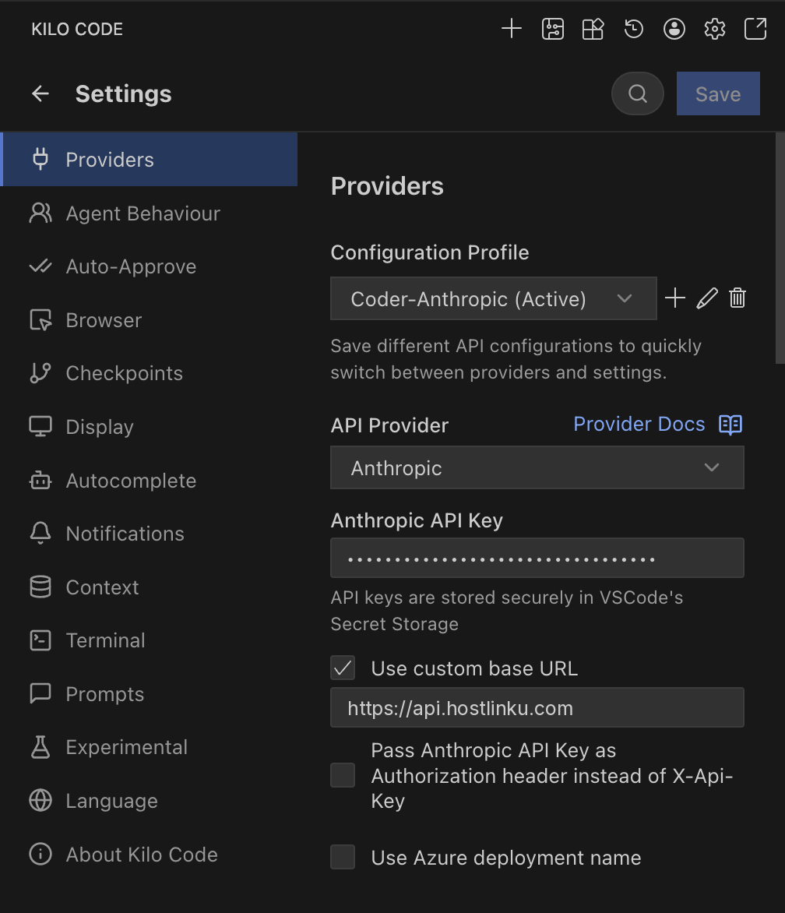

import { Callout, Steps } from "/snippets/mdx.jsx";

[Kilo Code](https://kilocode.ai) — a coding agent extension for VS Code and JetBrains (a fork of
Cline/Roo Code) — saves provider settings per **Configuration Profile**. You can create a
separate Hostlinku profile from other profiles and switch between them with a single click.

**Prerequisites:** The Kilo Code extension must be installed, and you must have a Hostlinku API key (`sk-…`) from
[console](https://console.hostlinku.com) → **API Keys**.

<Steps>

### Create a profile

Open the Kilo Code panel → gear icon (**Settings**) → **Providers**. In **Configuration Profile**,
click **+** and name the profile (e.g., `Hostlinku`).

### Provider and base URL content

| Field | Value |
|---|---|
| **API Provider** | `OpenAI` |
| **Use custom base URL** | checked |
| **Base URL** | `https://api.hostlinku.com/v1` |
| **OpenAI API Key** | `sk-…` (Hostlinku API key) |
| **Model** | slug from [catalog](/en/models), e.g., `gpt-5-5` |

The `OpenAI` provider only displays models recognized by Kilo Code. For other slugs (Claude,
DeepSeek, GLM, Kimi, Qwen), select **OpenAI Compatible**—the base URL and API key are the same—then enter
the slug in the **Model ID** field.

### Save and test

Click **Save**, then submit a small task (*"summarize this repo’s README"*). The request appears in the console
→ **Request Log**.

</Steps>

## Alternative: provider Anthropic

Select **API Provider** `Anthropic`, check **Use custom base URL**, enter `https://api.hostlinku.com`
(**without** `/v1`), and paste your Hostlinku API key into **Anthropic API Key**. The list of models is limited
to Claude models recognized by Kilo Code—select those whose slugs match the Hostlinku catalog
(e.g., `claude-sonnet-4-6`, `claude-haiku-4-5`).

<Callout type="note" title="Prompt caching">
  Via the Anthropic pipeline, Kilo Code sends `cache_control` and Hostlinku forwards it—the cache token
  is reported in `cache_read_input_tokens` and billed at the model cache rate. See
  [Prompt Caching](/en/prompt-caching).
</Callout>

## What You Need to Know

- **One profile per mode.** Kilo Code can use different profiles for the *Architect*, *Code*,
  and *Debug* modes. Example: Architect = `claude-opus-4-6`, Code = `claude-sonnet-4-6`.
- **Custom headers are not required.** Hostlinku only needs to use the API key; leave the custom
  headers section blank.
- **Inline autocomplete** Kilo Code uses FIM endpoints not served by Hostlinku—leave
  that feature with the default provider (see [Overview](/integrations#compatibility-limits)).

## Troubleshooting

| Symptoms | Solution |
|---|---|
| `401` | Key is incorrect/revoked, or entered in another profile—make sure the **Hostlinku** profile is active. |
| `404` in all requests | The Base URL is missing `/v1` (OpenAI path) or, conversely, uses `/v1` in the Anthropic path. Compare with the screenshot above. |
| `404 model_not_found` | The Model ID is a typo; copy it from `GET /v1/models`. |
| The Claude/DeepSeek model is not in the dropdown menu | The `OpenAI` provider displays only OpenAI models—use **OpenAI Compatible**. |
| The agent stops without calling the tool | Check for *tool calling* support for models in the [catalog](/en/models). |
