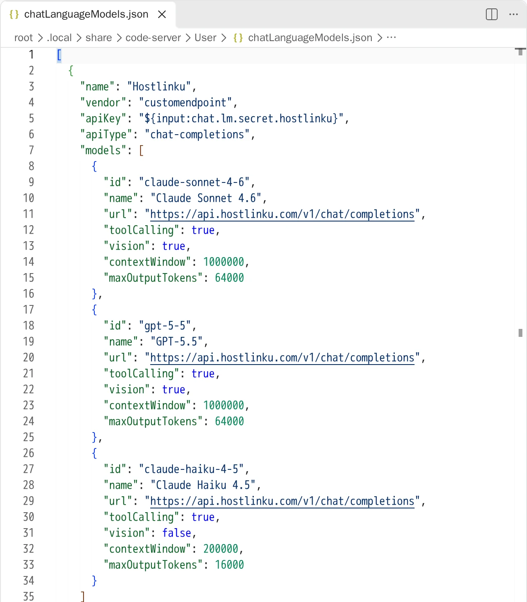
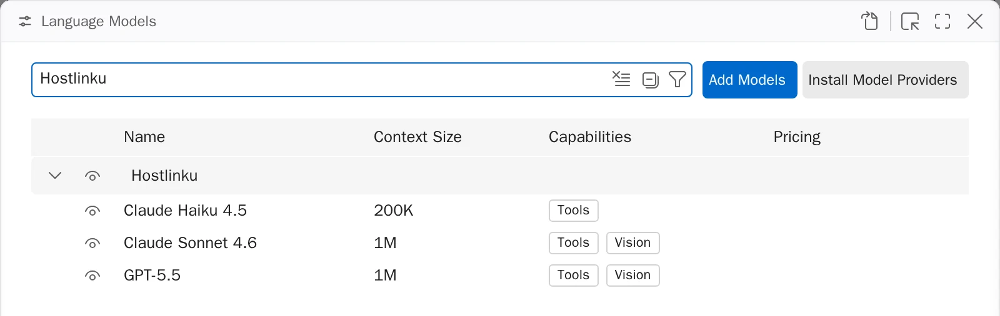
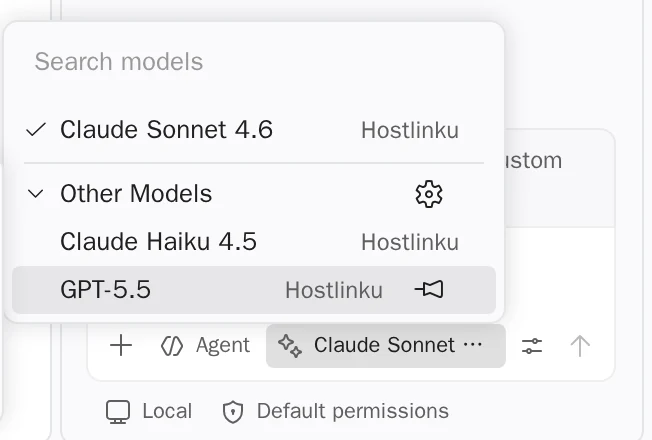

import { Callout, Steps } from "/snippets/mdx.jsx";

The built-in chat in [VS Code](https://code.visualstudio.com/docs/agent-customization/language-models)
(Chat panel, Agent mode, and inline chat) can use external models via the **Custom
Endpoint** provider. This provider supports three API formats—Chat Completions, Responses, and Anthropic
Messages—and all three are served by Hostlinku. A BYOK model like this **does not require a GitHub login
or the Copilot package**.

**Prerequisites:** The latest version of VS Code (Custom Endpoint replaces the deprecated *OpenAI Compatible*
provider) and the
[GitHub Copilot Chat](https://marketplace.visualstudio.com/items?itemName=GitHub.copilot-chat).

<Steps>

<a id="tambahkan-provider-custom-endpoint"></a>

### Add a Custom Endpoint provider

Open the Command Palette (⌘/Ctrl + Shift + P) → **Chat: Manage Language Models** → **Add Models** →
**Custom Endpoint**. Then fill in:

| Prompt | Value |
|---|---|
| **Group name** | `Hostlinku` |
| **Display name** | `Hostlinku` |
| **API key** | `sk-…` (Hostlinku API key) |
| **API type** | **Chat Completions** |

VS Code stores the API key in secret storage and writes a reference to it
(`${input:chat.lm.secret.…}`) to `chatLanguageModels.json`. **Do not** paste the raw key into the
JSON file.

<a id="daftarkan-model-hostlinku"></a>

<a id="register-your-hostlinku-model"></a>

### List the Hostlinku models

VS Code opens `chatLanguageModels.json`. Populate the `models` array with slugs from
[the catalog](/en/models) — leave the `apiKey` value as generated by VS Code:

```json
[
  {
    "name": "Hostlinku",
    "vendor": "customendpoint",
    "apiKey": "${input:chat.lm.secret.XXXXX}",
    "apiType": "chat-completions",
    "models": [
      {
        "id": "claude-sonnet-4-6",
        "name": "Claude Sonnet 4.6",
        "url": "https://api.hostlinku.com/v1/chat/completions",
        "toolCalling": true,
        "vision": true,
        "contextWindow": 1000000,
        "maxOutputTokens": 64000
      },
      {
        "id": "gpt-5-5",
        "name": "GPT-5.5",
        "url": "https://api.hostlinku.com/v1/chat/completions",
        "toolCalling": true,
        "vision": true,
        "contextWindow": 1000000,
        "maxOutputTokens": 64000
      },
      {
        "id": "claude-haiku-4-5",
        "name": "Claude Haiku 4.5",
        "url": "https://api.hostlinku.com/v1/chat/completions",
        "toolCalling": true,
        "vision": false,
        "contextWindow": 200000,
        "maxOutputTokens": 16000
      }
    ]
  }
]
```

`contextWindow` and `maxOutputTokens` above are examples of VS Code-specific limits. Adjust them according to the model page in the [catalog](/en/models); smaller values restrict usage within the tool.



Write `url` **complete with the endpoint path** (`/v1/chat/completions`) so that VS Code doesn’t have to
guess. `toolCalling: true` is required for the model to appear in **Agent** mode.

<a id="pilih-model-di-chat"></a>

### Select a model in Chat

Save the file. The Hostlinku model appears in **Chat: Manage Language Models**, complete with its
context size and capabilities:



Then select a model from the model picker in the Chat panel (restart VS Code if it doesn’t appear). The
first request appears in the console → **Request Log**.



</Steps>

<a id="format-api-lain"></a>

## Other API formats

Each model may use a different format via `apiType` per model:

| `apiType` | `url` | Notes |
|---|---|---|
| `chat-completions` | `https://api.hostlinku.com/v1/chat/completions` | Recommended default—all catalog models. |
| `messages` | `https://api.hostlinku.com/v1/messages` | Anthropic format; VS Code sends the key as `x-api-key` (accepted by the gateway). |
| `responses` | `https://api.hostlinku.com/v1/responses` | **Required**: Add `"statefulResponses": false`—see below. |

<Callout type="important" title="Hostlinku API responses are stateless">
  By default, VS Code sends `previous_response_id` for models with `apiType: "responses"`,
  whereas Hostlinku does not store responses, so such requests are rejected with a `400` error. If
  you want to use the Responses API, add `"statefulResponses": false` to that model so that VS
  Code sends the full conversation history. See [Responses API](/en/responses).
</Callout>

```json
{
  "id": "gpt-5-5",
  "name": "GPT-5.5 (Responses)",
  "url": "https://api.hostlinku.com/v1/responses",
  "apiType": "responses",
  "statefulResponses": false,
  "toolCalling": true,
  "vision": true,
  "contextWindow": 1000000,
  "maxOutputTokens": 64000
}
```

<a id="yang-perlu-diketahui"></a>

## What You Need to Know

- **Inline suggestions (autocomplete) should continue to use Copilot.** BYOK applies only to chat and
  utility tasks; semantic search, embeddings, and code completions require a GitHub account.
- **Without a GitHub login**, VS Code prompts you to select a *utility model* (session title, commit message,
  etc.). Set the `chat.utilityModel` and `chat.utilitySmallModel` settings to the Hostlinku model—
  `claude-haiku-4-5` is suitable for the *small* model.
- **Copilot Business/Enterprise:** Organization admins must enable the *Bring Your Own
  Language Model Key in VS Code* policy in the Copilot GitHub settings.
- **Untrusted workspace** (Restricted Mode) displays only **Auto** models; trust
  the workspace to display Hostlinku models.

## Troubleshooting

| Symptoms | Solution |
|---|---|
| "Model" does not appear in Agent mode | Set `"toolCalling": true` and use models with *tool calling* from the catalog. |
| `401` | Invalid/revoked API key—update via the provider’s gear icon in the Language Models editor. |
| `404 model_not_found` | `id` must be the exact slug from `GET /v1/models`. |
| `400` refers to `previous_response_id` | Models with `apiType: "responses"` without `"statefulResponses": false`. |
| New models are not displayed | Restart VS Code after saving `chatLanguageModels.json`. |
