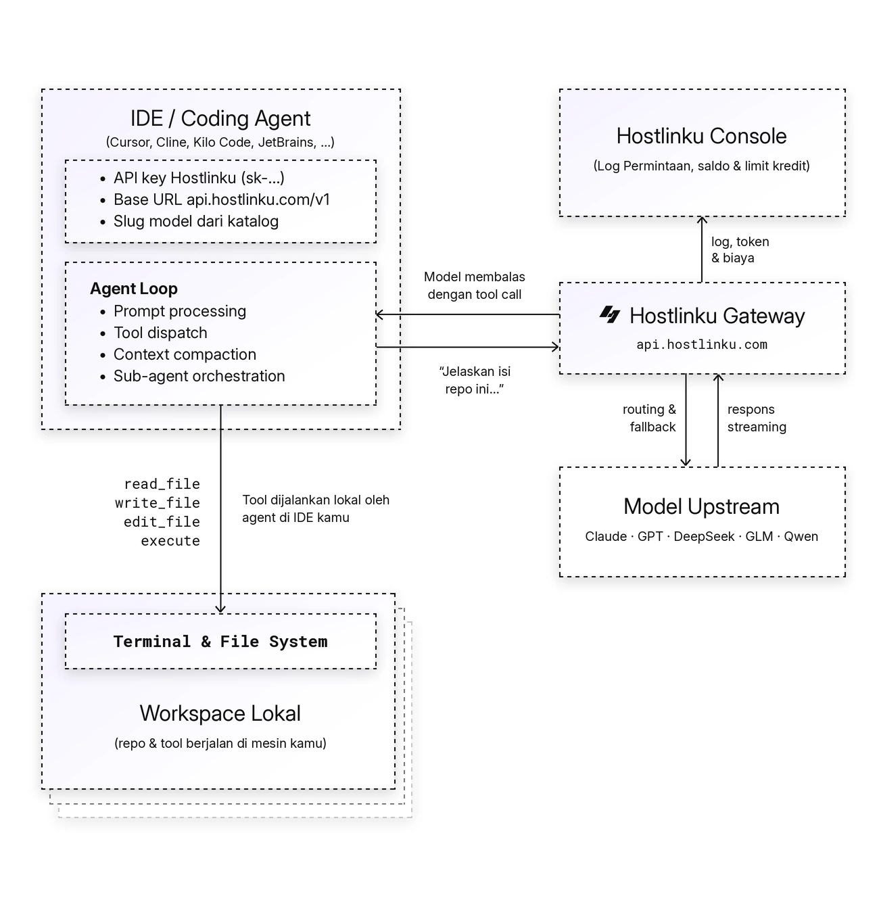

import { Callout, Steps } from "/snippets/mdx.jsx";

[OpenAI Agents SDK](https://openai.github.io/openai-agents-python/) secara default memakai
**Responses API**, yang disediakan Hostlinku di [`POST /v1/responses`](/responses). Cukup
berikan client OpenAI dengan `base_url` Hostlinku, dan matikan tracing (tracing diekspor ke
platform OpenAI, bukan lewat gateway).

<Callout type="note" title="Kompatibilitas model dan tool">
  Pilih model yang tersedia untuk Service Mode API key. Dukungan vision, JSON schema, reasoning, dan tool calling mengikuti model serta jalur protokolnya. Lihat [batas kompatibilitas](/responses).
</Callout>

<Steps>


### Instal

```bash
pip install openai-agents            # Python
npm install @openai/agents openai    # TypeScript / Node.js
```

### Python

```python
import os
from openai import AsyncOpenAI
from agents import Agent, Runner, function_tool, set_default_openai_client, set_tracing_disabled

client = AsyncOpenAI(
    base_url="https://api.hostlinku.com/v1",
    api_key=os.environ["HOSTLINKU_API_KEY"],
)
set_default_openai_client(client, use_for_tracing=False)
set_tracing_disabled(True)


@function_tool
def cuaca(kota: str) -> str:
    """Cuaca saat ini di sebuah kota."""
    return f"Cuaca di {kota}: cerah, 31°C"


agent = Agent(
    name="Asisten",
    instructions="Jawab singkat dalam bahasa Indonesia.",
    model="claude-sonnet-4-6",
    tools=[cuaca],
)

result = Runner.run_sync(agent, "Bagaimana cuaca di Jakarta hari ini?")
print(result.final_output)
```

### TypeScript

```ts
import OpenAI from "openai";
import { Agent, run, tool, setDefaultOpenAIClient, setTracingDisabled } from "@openai/agents";
import { z } from "zod";

setDefaultOpenAIClient(
  new OpenAI({ baseURL: "https://api.hostlinku.com/v1", apiKey: process.env.HOSTLINKU_API_KEY })
);
setTracingDisabled(true);

const cuaca = tool({
  name: "cuaca",
  description: "Cuaca saat ini di sebuah kota",
  parameters: z.object({ kota: z.string() }),
  execute: async ({ kota }) => `Cuaca di ${kota}: cerah, 31°C`,
});

const agent = new Agent({
  name: "Asisten",
  instructions: "Jawab singkat dalam bahasa Indonesia.",
  model: "gpt-5-5",
  tools: [cuaca],
});

const result = await run(agent, "Bagaimana cuaca di Jakarta hari ini?");
console.log(result.finalOutput);
```

### Verifikasi

Jika model memanggil tool, contoh ini biasanya menghasilkan dua request di **Log Permintaan**: giliran tool call dan giliran jawaban.

</Steps>

## Cara kerja agent loop

Agent mengirim prompt ke gateway. Jika model meminta tool, SDK menjalankannya lalu mengirim hasilnya kembali hingga jawaban selesai. Setiap panggilan model memiliki request tersendiri di **Log Permintaan**.



## Tanpa mengubah kode: environment variable

SDK OpenAI membaca `OPENAI_BASE_URL` dan `OPENAI_API_KEY`, sehingga Agents SDK bisa diarahkan ke
Hostlinku tanpa menyentuh kode - cukup matikan tracing lewat env juga:

```bash
export OPENAI_BASE_URL=https://api.hostlinku.com/v1
export OPENAI_API_KEY=sk-your-api-key          # API key Hostlinku
export OPENAI_AGENTS_DISABLE_TRACING=1
python agent.py
```

## Responses API atau Chat Completions?

Default SDK memakai Responses API (`/v1/responses`). Dukungan reasoning dan tool mengikuti model serta jalur native/bridge. Untuk memakai Chat Completions (`/v1/chat/completions`):

```python
from agents import set_default_openai_api
set_default_openai_api("chat_completions")
```

```ts
import { setOpenAIAPI } from "@openai/agents";
setOpenAIAPI("chat_completions");
```

Keduanya memakai API key, saldo, dan Request Logs yang sama.

<Callout type="important" title="Stateless: jangan pakai previous_response_id / conversation">
  Hostlinku tidak menyimpan response. Biarkan `Runner`/`run` mengelola riwayat (default SDK mengirim
  seluruh riwayat di `input` pada setiap giliran). Jangan set `previous_response_id`,
  `conversation_id`, atau `OpenAIConversationsSession` - gateway menolaknya dengan
  `400 invalid_request_error`. Session lokal seperti `SQLiteSession` tetap bisa dipakai karena
  riwayatnya disimpan di sisi kamu.
</Callout>

## Yang didukung lewat gateway

| Fitur Agents SDK | Status |
|---|---|
| `function_tool` / `tool()`, parallel tool calls | Tersedia bila model mendukung function calling; parallel tool calls mengikuti model. |
| Handoffs antar agent (termasuk model berbeda per agent) | Ya - campur `claude-sonnet-4-6` dan `gpt-5-5` dalam satu alur |
| Structured output (`output_type` / Zod) | Ya pada model yang mendukung JSON schema |
| Streaming (`Runner.run_streamed`, `run(..., { stream: true })`) | Ya |
| `reasoning={"effort": …}` via `ModelSettings` | Diterima; nilai dan hasil mengikuti model serta jalur protokol. |
| Hosted tools OpenAI (`WebSearchTool`, `FileSearchTool`, `CodeInterpreterTool`) | Bergantung pada Responses native upstream; bridge chat hanya menerjemahkan tool `type: "function"`. Gunakan function tool sendiri bila hosted tool tidak tersedia. |
| Tracing ke platform OpenAI | Tidak lewat gateway - matikan, atau gunakan trace processor pihak ketiga |

## Troubleshooting

- **Log penuh error *tracing export 401*** - tracing belum dimatikan; panggil
  `set_tracing_disabled(True)` / `setTracingDisabled(true)` atau set `OPENAI_AGENTS_DISABLE_TRACING=1`.
- **`400 previous_response_id tidak didukung`** - hapus penggunaan `previous_response_id` /
  `conversation_id`; lihat callout di atas.
- **`404 model_not_found`** - `model=` harus slug Hostlinku, bukan nama model OpenAI/Anthropic asli.
