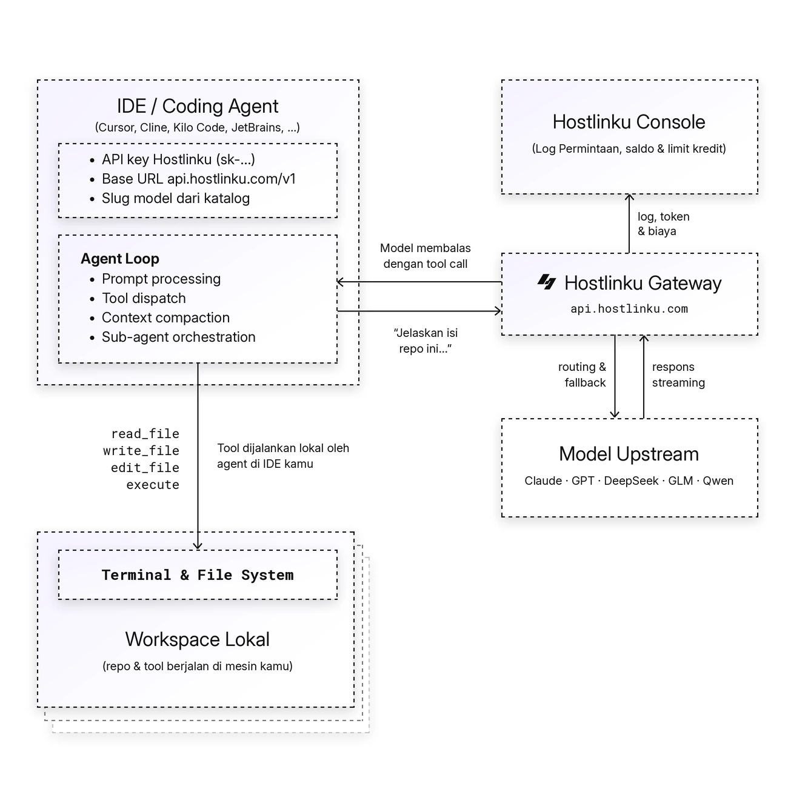

import { Callout, Steps } from "/snippets/mdx.jsx";

[OpenAI Agents SDK](https://openai.github.io/openai-agents-python/) は、デフォルトで [`POST /v1/responses`](/ja/responses) の Hostlinku によって提供される **Responses API** を使用します。 OpenAIクライアントに`base_url` Hostlinkuを指定し、トレースを無効にしてください（トレースはゲートウェイを経由せず、OpenAIプラットフォームにエクスポートされます）。

<Callout type="note" title="モデルとツールの互換性">
  API キーの Service Mode で利用可能なモデルを選択してください。vision、JSON schema、reasoning、tool calling はモデルと経路に依存します。[互換性の制限](/ja/responses)を参照してください。
</Callout>

<Steps>


### インストール

```bash
pip install openai-agents            # Python
npm install @openai/agents openai    # TypeScript / Node.js
```

### Python

```python
import os
from openai import AsyncOpenAI
from agents import Agent, Runner, function_tool, set_default_openai_client, set_tracing_disabled

client = AsyncOpenAI(
    base_url="https://api.hostlinku.com/v1",
    api_key=os.environ["HOSTLINKU_API_KEY"],
)
set_default_openai_client(client, use_for_tracing=False)
set_tracing_disabled(True)


@function_tool
def cuaca(kota: str) -> str:
    """Cuaca saat ini di sebuah kota."""
    return f"Cuaca di {kota}: cerah, 31°C"


agent = Agent(
    name="Asisten",
    instructions="Jawab singkat dalam bahasa Indonesia.",
    model="claude-sonnet-4-6",
    tools=[cuaca],
)

result = Runner.run_sync(agent, "Bagaimana cuaca di Jakarta hari ini?")
print(result.final_output)
```

### TypeScript

```ts
import OpenAI from "openai";
import { Agent, run, tool, setDefaultOpenAIClient, setTracingDisabled } from "@openai/agents";
import { z } from "zod";

setDefaultOpenAIClient(
  new OpenAI({ baseURL: "https://api.hostlinku.com/v1", apiKey: process.env.HOSTLINKU_API_KEY })
);
setTracingDisabled(true);

const cuaca = tool({
  name: "cuaca",
  description: "Cuaca saat ini di sebuah kota",
  parameters: z.object({ kota: z.string() }),
  execute: async ({ kota }) => `Cuaca di ${kota}: cerah, 31°C`,
});

const agent = new Agent({
  name: "Asisten",
  instructions: "Jawab singkat dalam bahasa Indonesia.",
  model: "gpt-5-5",
  tools: [cuaca],
});

const result = await run(agent, "Bagaimana cuaca di Jakarta hari ini?");
console.log(result.finalOutput);
```

### 確認

モデルがツールを呼ぶ場合、この例は通常ツール呼び出しと回答の 2 件を**リクエストログ**に記録します。

</Steps>

## エージェントループの仕組み

agent は gateway に prompt を送ります。モデルがツールを要求すると SDK が実行し、結果を送り返して回答まで続けます。各モデル呼び出しは**リクエストログ**で個別の request になります。



## コードを変更せずに：環境変数

SDK OpenAI は `OPENAI_BASE_URL` および `OPENAI_API_KEY` を読み取るため、コードを変更することなく Agents SDK を Hostlinku にリダイレクトできます。環境変数でトレースを無効にするだけで済みます：

```bash
export OPENAI_BASE_URL=https://api.hostlinku.com/v1
export OPENAI_API_KEY=sk-your-api-key          # API key Hostlinku
export OPENAI_AGENTS_DISABLE_TRACING=1
python agent.py
```

## Responses API か、それとも Chat Completions か？

SDK のデフォルトは Responses API (`/v1/responses`) です。reasoning とツールの対応はモデルと native/bridge 経路に依存します。Chat Completions (`/v1/chat/completions`) を使用する場合：

```python
from agents import set_default_openai_api
set_default_openai_api("chat_completions")
```

```ts
import { setOpenAIAPI } from "@openai/agents";
setOpenAIAPI("chat_completions");
```

両者とも、同じAPIキー、残高、およびリクエストログを使用しています。

<Callout type="important" title="Stateless：previous_response_id / conversation を使用しないでください">
Hostlinkuはレスポンスを保存しません。履歴の管理は`Runner`/`run`に任せてください（デフォルトのSDKでは、各ターンごとに`input`に履歴全体を送信します）。 `previous_response_id`、`conversation_id`、または`OpenAIConversationsSession`を設定しないでください。ゲートウェイはこれらを`400 invalid_request_error`で拒否します。`SQLiteSession`のようなローカルセッションは、履歴がユーザー側で保存されるため、引き続き使用可能です。
</Callout>

## ゲートウェイ経由でサポートされるもの

| Agents SDKの機能 | ステータス |
|---|---|
| `function_tool` / `tool()`、並列ツール呼び出し | function calling 対応モデルで利用可能。並列呼び出しはモデルに依存します。 |
| エージェント間のハンドオフ（エージェントごとに異なるモデルを含む） | はい-`claude-sonnet-4-6`と`gpt-5-5`を1つのフローで組み合わせてください |
| 構造化出力 (`output_type` / Zod) | はい、JSONスキーマに対応しているモデルでは |
| ストリーミング (`Runner.run_streamed`、`run(..., { stream: true })`) | はい |
| `reasoning={"effort": …}` 経由 `ModelSettings` | 受理されます。値と結果はモデル・プロトコル経路に依存します。 |
| ホスト型ツール OpenAI (`WebSearchTool`、`FileSearchTool`、`CodeInterpreterTool`) | upstream の Responses ネイティブ対応に依存します。chat ブリッジは `type: "function"` のみ変換します。利用できない hosted tool は自作 function tool で代替してください。 |
| OpenAIプラットフォームへのトレース | ゲートウェイを経由しない - 無効にするか、サードパーティ製のトレースプロセッサを使用する |

## トラブルシューティング

- **エラーログ *tracing export 401* が満杯です*** - トレースがまだ無効化されていません。`set_tracing_disabled(True)` / `setTracingDisabled(true)` を呼び出すか、`OPENAI_AGENTS_DISABLE_TRACING=1` を設定してください。
- **`400 previous_response_id はサポートされていません`** - `previous_response_id` / `conversation_id` の使用を削除してください。上記の注記を参照してください。
- **`404 model_not_found`** - `model=`のslugはHostlinkuとするべきであり、元のモデル名であるOpenAI/Anthropicではない。
