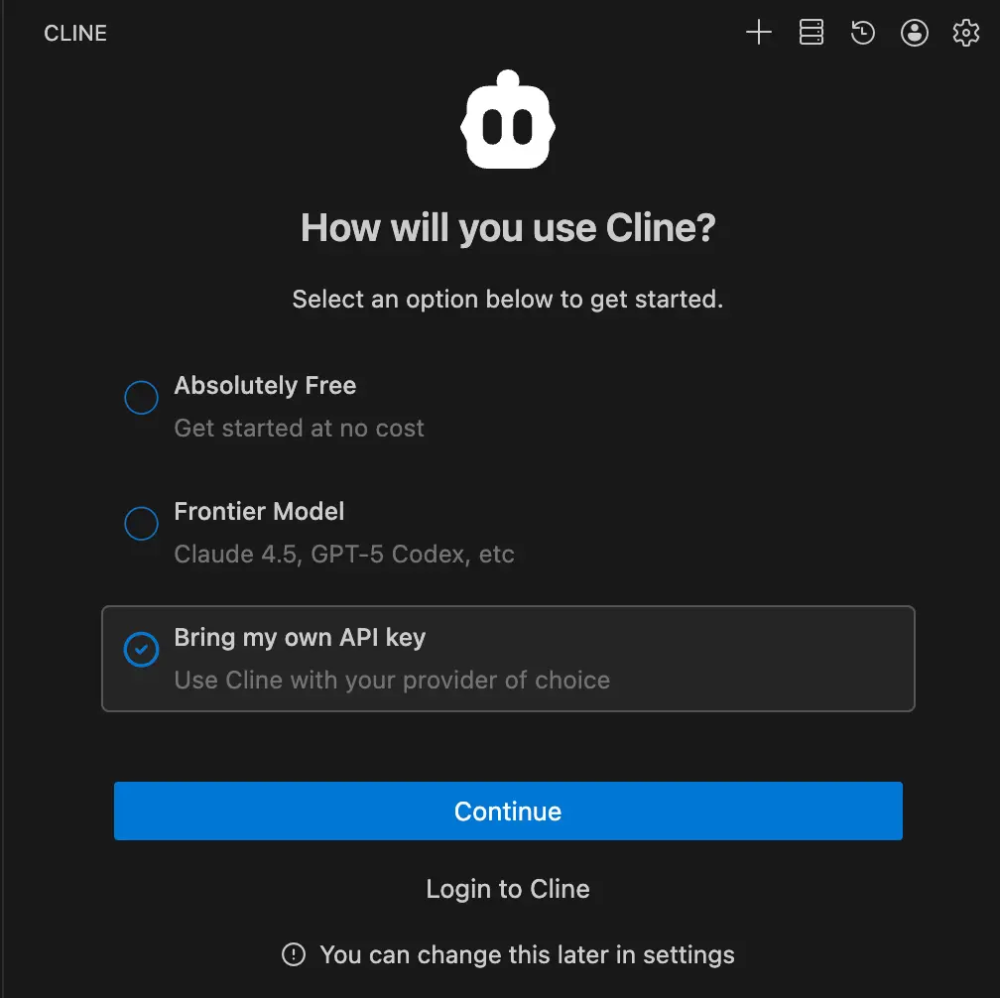
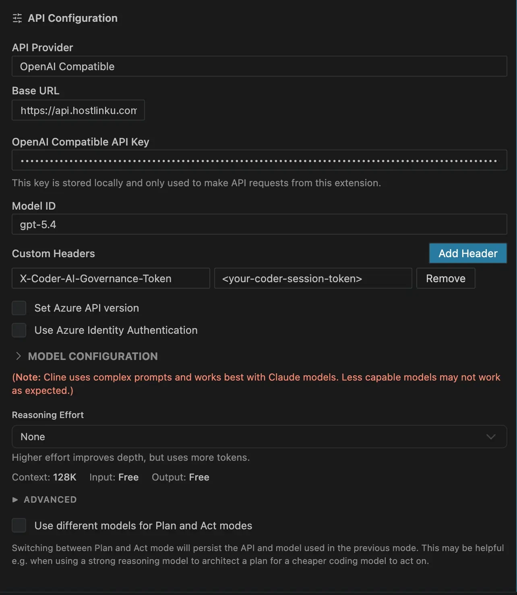

import { Callout, Steps } from "/snippets/mdx.jsx";

[Cline](https://cline.bot) — およびそのフォークである **Roo Code** — は、
ベースURL、APIキー、および任意のモデルIDを受け付ける **OpenAI互換** のプロバイダーを提供しています。これは
Hostlinkuにとって最もシンプルな方法です。**Anthropic**プロバイダーを経由する代替方法については、以下で説明します。
**Kilo Code**をご利用ですか？ [Kilo Code](/ja/integrations/kilo-code)の専用ガイドをご覧ください。

<Steps>

<a id="buka-pengaturan-provider"></a>

### プロバイダーの設定を開く

Clineパネルで、歯車アイコン（**Settings**）→ **API Configuration** をクリックします。

Clineを初めて起動すると、*How will you use Cline?*という画面が表示されます。**Bring my
own API key**を選択し、**Continue**をクリックしてください。



<a id="pilih-openai-compatible-dan-isi"></a>

### 「OpenAI Compatible」を選択し、入力してください

| フィールド | 値 |
|---|---|
| **APIプロバイダー** | `OpenAI Compatible` |
| **Base URL** | `https://api.hostlinku.com/v1` |
| **APIキー** | `sk-…`（HostlinkuのAPIキー） |
| **モデルID** | [カタログ](/ja/models)のスラグ、例：`claude-sonnet-4-6` |

。")

<a id="disarankan-lengkapi-model-configuration"></a>

<a id="推奨モデル構成を完了してください"></a>

### （推奨）モデル構成を補完する

Clineがコンテキストと価格を正しく管理できるように、**Model Configuration**セクションを開いてください：

- **Supports Images**：画像処理モデル（`claude-sonnet-4-6`、`gpt-5-5`）の場合はチェックを入れてください。
- **コンテキストウィンドウサイズ**：カタログの `context_window`（例：`1000000`）。
- **Max Output Tokens**：[カタログ](/ja/models)に記載されているモデルの出力制限に従ってください。`64000`はあくまで一例です。モデルの制限がこれより低い場合は、より小さい値を使用してください。
- **入力／出力価格**：Clineの費用を正確に見積もりたい場合は、`pricing`カタログからコピーしてください。
  実際の請求額は、コンソールに記録されているものが基準となります。



<a id="verifikasi"></a>

<a id="確認"></a>

### 検証

**Done**をクリックし、小さなタスクを1つ送信してください（*「このリポジトリのREADMEを要約する」*）。リクエストはコンソールの →
**リクエストログ** に表示されます。

</Steps>

<a id="mode-plan--act-dengan-model-berbeda"></a>

<a id="異なるモデルを用いたplanactモード"></a>

## 異なるモデルによる「Plan / Act」モード

Clineは、**Plan**モードと**Act**モードで異なるモデルを使用できます。一般的なコスト削減の組み合わせ：
**Plan** = `claude-opus-4-6` または `gpt-5-5`（推論）、**Act** = `claude-sonnet-4-6` または
`deepseek-v4-flash`（実行）。設定で *「PlanモードとActモードで異なるモデルを使用する」* を有効にし、
同じプロバイダーのプロファイルに異なるモデルIDを入力してください。

<a id="alternatif-provider-anthropic"></a>

## 代替案：プロバイダー Anthropic

Clineには、**Anthropic**というプロバイダーもあり、*Use custom base URL*というオプションがあります。
`https://api.hostlinku.com`（`/v1`を除く）とHostlinkuのAPIキーを入力してください。違いは、このプロバイダーのモデル一覧が
**Clineが認識するIDに限定されている**点です。Hostlinkuのカタログとスラグが同一のClaudeモデルを選択してください
Hostlinkuのカタログと一致するClaudeモデルを選択してください（例：`claude-sonnet-4-6`、`claude-haiku-4-5`）。Claude以外のモデルや、リストに
ないスラッグの場合は、**OpenAI Compatible**を使用してください。

。")

<Callout type="note" title="プロンプトのキャッシュ">
  Anthropicルートでは、Clineが`cache_control`を送信し、Hostlinkuがそれを転送します。キャッシュトークンは
  `cache_read_input_tokens`で報告され、モデルキャッシュの料金が課金されます。OpenAI
  Compatibleルートでは、キャッシュはそれをサポートするモデルによって自動的に処理されます。
</Callout>

## Cline CLI

```bash
cline auth -p openai -k "$HOSTLINKU_API_KEY" -b https://api.hostlinku.com/v1
cline --model claude-sonnet-4-6 "tambahkan validasi input di handler login"
```

<a id="troubleshooting"></a>

## トラブルシューティング

- **`401`** - キーが間違っているか、無効化されています。Roo Codeでは、キーが現在
  アクティブなプロバイダーの**プロファイル**に設定されていることを確認してください。他のプロファイルではありません。
- **`404 model_not_found`** - モデルIDの入力ミス；`GET /v1/models`から転記。
- **すべてのリクエストにおける `404`** - ベースURLに `/v1`（OpenAIのパス）が欠けているか、あるいはAnthropicのパスで逆に `/v1` が使用されている。
  上のスクリーンショットと比較してください。
- **Actモードでの空のレスポンス** - [カタログ](/ja/models)のモデルにおける*tool calling*のサポートを確認してください。
- **コンテキストがすぐに使い切れてしまう** - Clineが履歴を正しく切り詰めるよう、カタログに従って*Context Window Size*を設定してください
。
