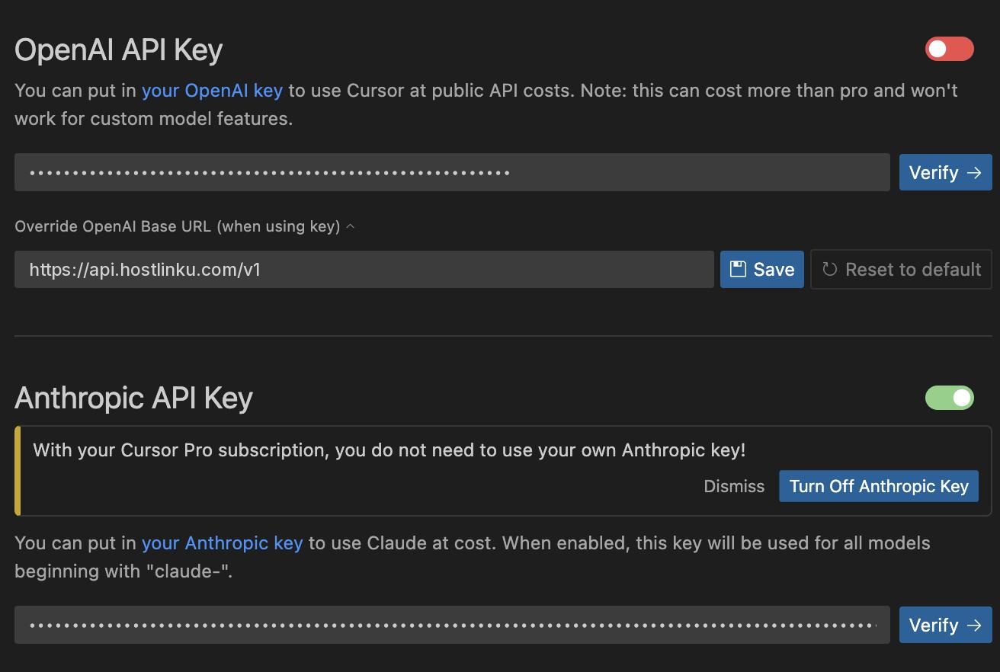

import { Callout, Steps } from "/snippets/mdx.jsx";

[Cursor](https://cursor.com) では、*Override OpenAI Base URL* を使用して独自の API キーを許可しています。
これをHostlinkuに設定することで、チャット、Cmd-K（インライン編集）、およびAgentは
Hostlinkuのカタログにあるモデルを使用し、Cursorのクォータではなく、あなたの残高から課金されます。

<Steps>

<a id="buka-pengaturan-model"></a>

### モデル設定を開く

`Cursor Settings` (⌘/Ctrl + Shift + J) → **Models** タブ。

<a id="isi-api-key-dan-base-url"></a>

### APIキーとベースURLを入力してください

**API Keys** のセクションでは：

1. **OpenAI API Key**を有効にし、HostlinkuのAPIキー（`sk-…`）を貼り付けてください。
2. **Override OpenAI Base URL** を有効にし、以下を入力してください：

```text
https://api.hostlinku.com/v1
```



末尾に `/chat/completions` を追加しないでください。Cursorが独自のパスを追加します。
**Save** をクリックし、APIキー欄の横にある **Verify** をクリックしてください。Cursorがゲートウェイに1つのテストリクエストを送信します。

<a id="tambahkan-model-hostlinku"></a>

<a id="モデル-hostlinku-を追加する"></a>

### Hostlinkuモデルを追加してください

引き続き**Models**タブ → **Add Custom Model**で、
[カタログ](/ja/models)にあるスラグを、1つずつ正確に入力してください：

```text
claude-sonnet-4-6
gpt-5-5
deepseek-v4-flash
```

使用しないデフォルトのモデルは無効にして、モデル選択リストを簡潔に保ってください。

<a id="pilih-model-di-chat"></a>

### チャットでモデルを選択してください

「チャット/エージェント」パネルで、モデルドロップダウンから新しく追加されたモデルを選択してください。最初のリクエストは
コンソールの「**リクエストログ**」に表示されます。

</Steps>

<a id="yang-perlu-diketahui"></a>

<a id="知っておくべきこと"></a>

## 留意事項

<Callout type="warning" title="オーバーライドはグローバルな性質を持つ">
  **Override OpenAI Base URL**が有効な間、Cursor上のすべてのOpenAIファミリーモデル（
  Cursorが管理するモデルを含む）はHostlinkuにリダイレクトされます。すべてにHostlinkuのスラッグを使用するか、
  オーバーライドのトグルをオフにしてください。
</Callout>

- **リクエストはCursorサーバーから送信されます**。あなたのコンピュータからではありません。そのため、ベースURLは
  公開されている必要があります。`https://api.hostlinku.com`はこの条件を満たしています（`localhost`のアドレスはCursorで拒否されます）。
- **Cursorのタブ機能（オートコンプリート）は影響を受けません。** タブ機能はCursor独自のインフラストラクチャを使用しており、
  どのプロバイダーにも移行することはできません。Hostlinkuはチャット、Cmd-K、およびAgentに対応しています。
- **エージェントモード**には、*tool calling*および*streaming*が必要です。[カタログ](/ja/models)で対応状況を確認してください。*BAD_MODEL_NAME*が表示された場合は、スラグを確認し、**OpenAI API Key**のトグルがオンになっていることを確認してください。
- **接続がハングアップ／プロトコルエラー** - 同じ設定で、*HTTP Compatibility
  Mode* を **HTTP/1.1** に変更してください。

<Callout type="tip" title="OpenAI経由のClaudeモデル">
  *Anthropic API Key* 欄は入力する必要はありません。スラグ `claude-sonnet-4-6` は、
  OpenAI Chat Completions と同じパスを通じて呼び出され、Anthropic プロトコルに変換するゲートウェイを経由します。
</Callout>

<a id="troubleshooting"></a>

## トラブルシューティング

| 症状 | 解決策 |
|---|---|
| *Verify* が失敗 `401` | APIキーが間違っている、または無効になっている、あるいはスペースが誤ってコピーされている。 |
| *モデルが見つかりません* | Slugのスペルミス - `GET /v1/models`からコピーしてください。 |
| 回答が途切れています | モデルの出力上限がCursorの要求値よりも小さい場合、別のモデルまたは異なるサービスモードを試してください。 |
| エージェントが途中で停止し、`429`を返す | エージェントは多数のリクエストを並行して送信します。[使用状況と制限](/ja/usage-and-limits)を参照してください。 |
