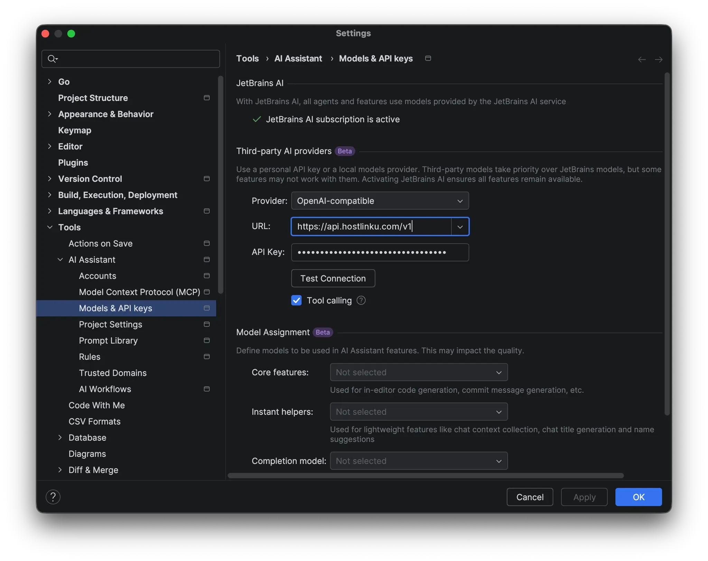
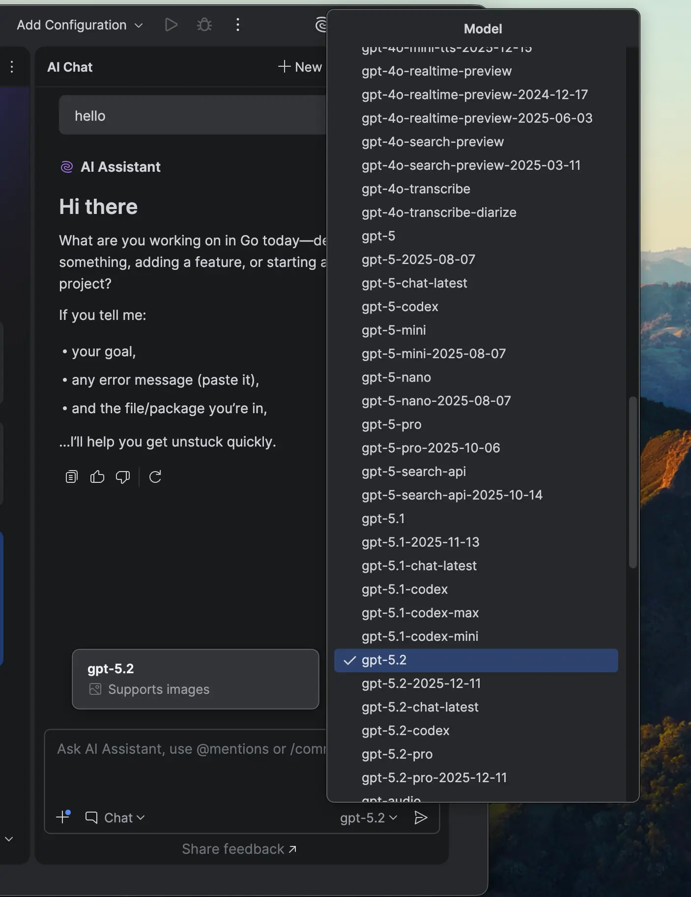

import { Callout, Steps } from "/snippets/mdx.jsx";

[JetBrains AI Assistant](https://www.jetbrains.com/help/ai-assistant/)は、**サードパーティのAI
プロバイダー**に対応しています。独自のAPIキーを使用して、AIチャットを任意の*OpenAI互換*エンドポイントに
リダイレクトできます。 これをHostlinkuに入力することで、IntelliJ IDEA、PyCharm、WebStorm、GoLand、Rider、
およびその他のJetBrains IDEでのチャットは、Hostlinkuのカタログにあるモデルを使用し、利用料金はあなたの残高から引き落とされます。

**前提条件：** **AI Assistant** プラグインがインストールされ、有効になっていること、および
[console](https://console.hostlinku.com) → **API Keys** から Hostlinku の API キー (`sk-…`) が取得されていること。

<Steps>

### モデル設定を開く

**Settings** (⌘ + , / Ctrl + Alt + S) → **Tools** → **AI Assistant** → **Models & API keys**。

### Hostlinkuをサードパーティプロバイダーとして追加してください

**サードパーティのAIプロバイダー**のセクションでは：

| フィールド | 値 |
|---|---|
| **プロバイダー** | `OpenAI-compatible` |
| **URL** | `https://api.hostlinku.com/v1` |
| **APIキー** | `sk-…`（HostlinkuのAPIキー） |
| **ツールの呼び出し** | チェック済み |

**Test Connection** をクリックすると、IDEがゲートウェイにテストリクエストを送信します。成功したら、**Apply**
をクリックし、続いて**OK**をクリックしてください。

### （オプション）モデルアサインメントの設定

**Model Assignment**セクションでは、**Core features**（例：
`claude-sonnet-4-6`）および**Instant helpers**（例：`claude-haiku-4-5`）用のHostlinkuモデルを選択できます。 **Completion model**は
*Not selected* のままにしておいてください。インラインオートコンプリートには、HostlinkuがサポートしていないFIMが使用されます（
[概要](/integrations#compatibility-limits)を参照）。

### AIチャットでモデルを選択してください

**AI Chat**を開き、**Chat**モードが有効になっていることを確認してから、モデルのドロップダウンからモデルを選択してください。リストは
`GET /v1/models`から取得されるため、表示されるスラッグは[カタログ](/ja/models)と同じです。

最初のリクエストはコンソールの「**リクエストログ**」に表示されます。

</Steps>

## 留意事項

<Callout type="note" title="OpenAI互換のパスに限定">
  AI Assistantは現在、サードパーティ向けには*OpenAI互換*のプロバイダーのみをサポートしており、AnthropicのベースURLオプションはまだありません。
  Claudeモデルは引き続き使用可能です：slug `claude-sonnet-4-6`は、
  Chat CompletionsおよびAnthropicプロトコルに変換するゲートウェイを介して呼び出されます。
</Callout>

- **Base URLは必ず`/v1`で終わらせる必要があります。** IDEは独自に`/models`および`/chat/completions`を追加します。
  `/v1`がない場合、*Test Connection*は`404`エラーで失敗します。
- **カスタムヘッダーはありません。** AIアシスタントはAPIキーを
  `Authorization: Bearer sk-…` として送信するのみです。これだけでHostlinkuには十分です。
- **IDEでのツール呼び出し**には、それをサポートするモデルが必要です。[カタログ](/ja/models)を確認し、モデル設定で**ツール呼び出し**にチェックを入れてください。
- **JetBrainsのClaude Code**は独立した統合機能です（Claude Codeプラグインは独自のCLIを使用します）。詳しくは
  [Claude Code](/ja/integrations/claude-code)をご覧ください。

## トラブルシューティング

| 症状 | 解決策 |
|---|---|
| *Test Connection* が失敗しました `401` | APIキーが間違っている、または無効になっている、あるいはスペースが誤ってコピーされている。 |
| *Test Connection* が失敗しました `404` | URLは `/v1` で終わらないか、`/chat/completions` のような追加のパスが含まれている。 |
| 空のドロップダウンモデル | 接続はまだ*適用*されていません、あるいはAPIキーはそのサービスモード上のどのモデルにもアクセス権を持っていません。 |
| チャットは `429` で終了します | 並列リクエストが多すぎます。[使用状況と制限](/ja/usage-and-limits)を参照してください。 |
