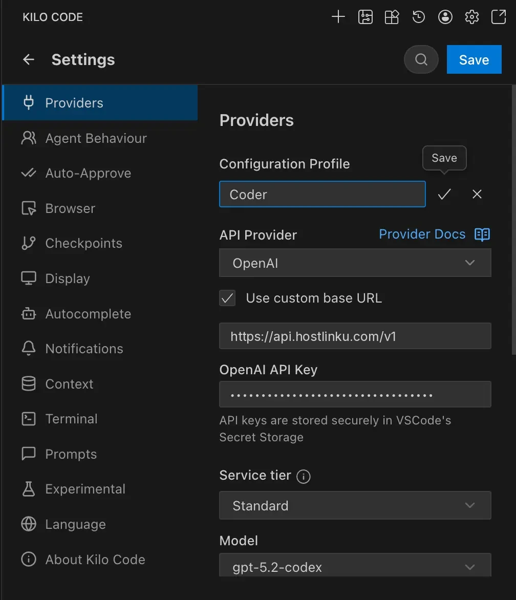

import { Callout, Steps } from "/snippets/mdx.jsx";

[Kilo Code](https://kilocode.ai) - VS CodeおよびJetBrains用のコーディングエージェント拡張機能（
Cline/Roo Codeのフォーク） - **Configuration Profile**ごとにプロバイダーの設定を保存します。Hostlinku用の
プロファイルを他のプロファイルとは別に作成し、ワンクリックで切り替えることができます。

**前提条件：** Kilo Code 拡張機能がインストールされており、[console](https://console.hostlinku.com) → **API Keys** から Hostlinku の API キー (`sk-…`) が取得されていること。

<Steps>

### プロフィールを作成する

Kilo Code パネルを開き、歯車アイコン（**Settings**）→ **Providers** を選択します。**Configuration Profile** で、
**+** をクリックし、プロファイルに名前を付けます（例：`Hostlinku`）。

### プロバイダーおよびベースURLの内容

| フィールド | 値 |
|---|---|
| **APIプロバイダー** | `OpenAI` |
| **カスタムベースURLを使用** | チェック済み |
| **Base URL** | `https://api.hostlinku.com/v1` |
| **OpenAI APIキー** | `sk-…`（HostlinkuのAPIキー） |
| **モデル** | [カタログ](/ja/models)のスラグ、例：`gpt-5-5` |

プロバイダー `OpenAI` では、Kilo Codeが認識しているモデルのみが表示されます。その他のスラッグ（Claude、
DeepSeek、GLM、Kimi、Qwen）については、**OpenAI Compatible** を選択してください（ベースURLとAPIキーは同じです）。その後、
**Model ID** にスラッグを入力してください。

### 保存して試してみてください

**Save**をクリックし、小さなタスクを1つ送信してください（*「このリポジトリのREADMEを要約する」*）。リクエストはコンソールに表示されます
→ **リクエストログ**。

</Steps>

## 代替案：プロバイダー Anthropic

**APIプロバイダー**として`Anthropic`を選択し、**Use custom base URL**にチェックを入れ、`https://api.hostlinku.com`
（`/v1`を**含めない**）を入力し、**Anthropic API Key**欄にHostlinkuのAPIキーを貼り付けてください。 利用可能なモデルは、
Kilo Codeが提供するClaudeモデルに限定されています。Hostlinkuのカタログとスラッグが一致するものを選択してください
（例：`claude-sonnet-4-6`、`claude-haiku-4-5`）。

")

<Callout type="note" title="プロンプトのキャッシュ">
  Anthropic経由で、Kilo Codeが`cache_control`を送信し、Hostlinkuがそれを転送します。キャッシュトークンは
  `cache_read_input_tokens`で報告され、モデルキャッシュの料金が課金されます。
  [プロンプトキャッシュ](/ja/prompt-caching)を参照してください。
</Callout>

## 留意事項

- **モードごとに1つのプロファイル。** Kilo Codeでは、*Architect*、*Code*、
  および*Debug*モードで異なるプロファイルを使用できます。簡潔な例：Architect = `claude-opus-4-6`、Code = `claude-sonnet-4-6`。
- **カスタムヘッダーは不要です。** HostlinkuではAPIキーのみを使用するため、カスタム
  ヘッダーの欄は空欄にしてください。
- **インラインオートコンプリート** Kilo Codeは、Hostlinkuが提供していないFIMエンドポイントを使用しています。この機能は
  デフォルトのプロバイダーのままにしておいてください（[概要](/integrations#compatibility-limits)を参照）。

## トラブルシューティング

| 症状 | 解決策 |
|---|---|
| `401` | キーが間違っている、無効になっている、または別のプロファイルに登録されている場合、**Hostlinku**のプロファイルがアクティブであることを確認してください。 |
| すべてのリクエストにおける `404` | Base URLには`/v1`（OpenAIのパス）が含まれていないか、あるいはAnthropicのパスでは`/v1`が使用されている場合があります。上記のスクリーンショットと比較してください。 |
| `404 model_not_found` | Model IDに誤字があります。`GET /v1/models`から転記してください。 |
| Claude/DeepSeekモデルはドロップダウンに表示されません | プロバイダー `OpenAI` は OpenAI モデルのみを表示します。**OpenAI Compatible** を使用してください。 |
| Agentはツールを呼び出さずに停止する | [カタログ](/ja/models)のモデルにおける「*tool calling*」のサポート状況を確認してください。 |
