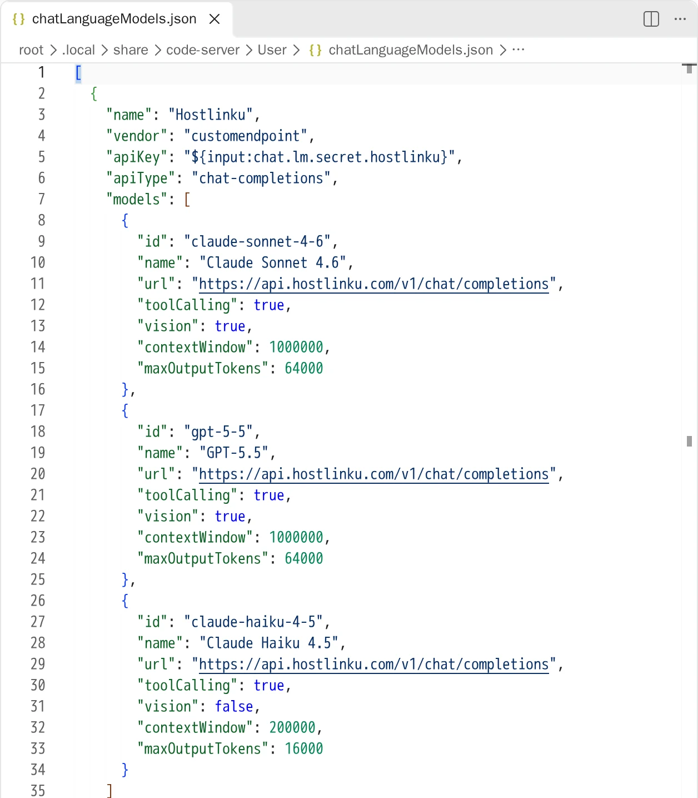
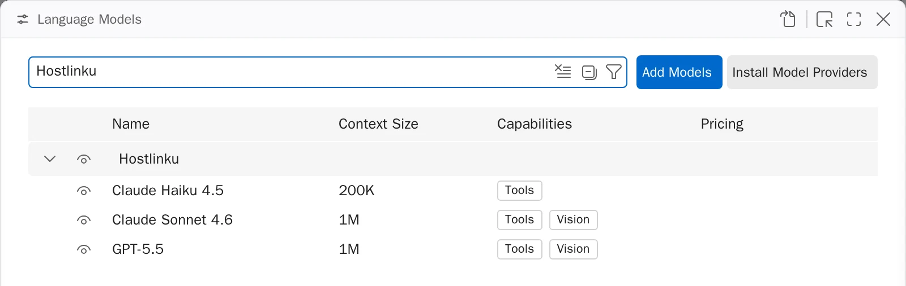
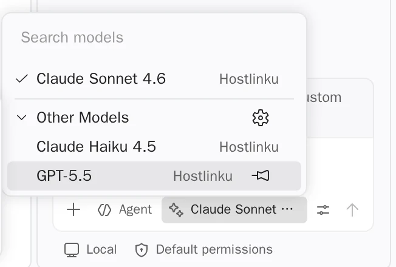

import { Callout, Steps } from "/snippets/mdx.jsx";

[VS Code](https://code.visualstudio.com/docs/agent-customization/language-models)に組み込まれたチャット
（チャットパネル、エージェントモード、インラインチャット）は、**Custom
Endpoint**プロバイダーを通じて外部モデルを利用できます。このプロバイダーは、Chat Completions、Responses、Anthropic
Messagesの3つのAPIフォーマットをサポートしており、これら3つすべてをHostlinkuが提供しています。このようなBYOKモデルでは、**GitHubへのログイン
やCopilotパッケージは不要**です。

**前提条件：** 最新バージョンの VS Code（カスタムエンドポイントは、すでに非推奨となった *OpenAI Compatible*
プロバイダーに代わるもの）および拡張機能
[GitHub Copilot Chat](https://marketplace.visualstudio.com/items?itemName=GitHub.copilot-chat)が必要です。

<Steps>

<a id="tambahkan-provider-custom-endpoint"></a>

### カスタムエンドポイントのプロバイダーを追加する

コマンドパレット（⌘/Ctrl + Shift + P）を開き → **Chat: Manage Language Models** → **Add Models** →
**Custom Endpoint** を選択します。次に、以下を入力してください：

| プロンプト | 値 |
|---|---|
| **グループ名** | `Hostlinku` |
| **表示名** | `Hostlinku` |
| **APIキー** | `sk-…`（HostlinkuのAPIキー） |
| **APIタイプ** | **Chat Completions** |

VS CodeはAPIキーをシークレットストレージに保存し、その参照
(`${input:chat.lm.secret.…}`)を`chatLanguageModels.json`に記述します。**生のキーを**JSONファイルに貼り付けないでください
。

<a id="daftarkan-model-hostlinku"></a>

<a id="モデル-hostlinku-を登録する"></a>

### Hostlinkuのモデルを登録する

VS Codeで`chatLanguageModels.json`を開きます。`models`配列に、
[カタログ](/ja/models) からのスラッグを入力し、VS Codeが自動的に生成した`apiKey`の値はそのままにしておきます：

```json
[
  {
    "name": "Hostlinku",
    "vendor": "customendpoint",
    "apiKey": "${input:chat.lm.secret.XXXXX}",
    "apiType": "chat-completions",
    "models": [
      {
        "id": "claude-sonnet-4-6",
        "name": "Claude Sonnet 4.6",
        "url": "https://api.hostlinku.com/v1/chat/completions",
        "toolCalling": true,
        "vision": true,
        "contextWindow": 1000000,
        "maxOutputTokens": 64000
      },
      {
        "id": "gpt-5-5",
        "name": "GPT-5.5",
        "url": "https://api.hostlinku.com/v1/chat/completions",
        "toolCalling": true,
        "vision": true,
        "contextWindow": 1000000,
        "maxOutputTokens": 64000
      },
      {
        "id": "claude-haiku-4-5",
        "name": "Claude Haiku 4.5",
        "url": "https://api.hostlinku.com/v1/chat/completions",
        "toolCalling": true,
        "vision": false,
        "contextWindow": 200000,
        "maxOutputTokens": 16000
      }
    ]
  }
]
```

上記の `contextWindow` および `maxOutputTokens` は、VS Code のローカル制限の例です。[カタログ](/ja/models) のモデルページに合わせて調整してください。値が小さいほど、ツールでの使用が制限されます。



VS Codeが推測する必要がないよう、`url`を**エンドポイントのパスを含めて完全に**（`/v1/chat/completions`）記述してください。
**Agent**モードでモデルを表示するには、`toolCalling: true`が必須です。

<a id="pilih-model-di-chat"></a>

<a id="チャットでモデルを選択してください"></a>

### Chatでモデルを選択

ファイルを保存します。Hostlinkuモデルが、**Chat: Manage Language Models** に、コンテキストサイズ
および機能情報とともに表示されます：



次に、チャットパネルのモデルセレクターからモデルを選択してください（表示されない場合はVS Codeを再起動してください）。最初のリクエストはコンソールに表示されます → **リクエストログ**。



</Steps>

<a id="format-api-lain"></a>

<a id="その他のapi形式"></a>

## その他のAPIフォーマット

各モデルは、モデルごとの `apiType` を通じて異なるフォーマットを使用できます：

| `apiType` | `url` | 注記 |
|---|---|---|
| `chat-completions` | `https://api.hostlinku.com/v1/chat/completions` | 推奨されるデフォルト設定 - すべてのカタログモデル。 |
| `messages` | `https://api.hostlinku.com/v1/messages` | Anthropicのフォーマット：VS Codeはキーを`x-api-key`として送信します（ゲートウェイで受け入れられます）。 |
| `responses` | `https://api.hostlinku.com/v1/responses` | **必須** `"statefulResponses": false` を追加してください - 下記を参照してください。 |

<Callout type="important" title="HostlinkuのAPIレスポンスはステートレスです">
  デフォルトでは、VS Codeは`apiType: "responses"`のモデルに対して`previous_response_id`を送信しますが、
  Hostlinkuはレスポンスを保存しないため、そのようなリクエストは`400`で拒否されます。
  Responses APIを使用したい場合は、そのモデルに`"statefulResponses": false`を追加して、VS
  Codeが会話の履歴全体を送信するようにしてください。[Responses API](/ja/responses)を参照してください。
</Callout>

```json
{
  "id": "gpt-5-5",
  "name": "GPT-5.5 (Responses)",
  "url": "https://api.hostlinku.com/v1/responses",
  "apiType": "responses",
  "statefulResponses": false,
  "toolCalling": true,
  "vision": true,
  "contextWindow": 1000000,
  "maxOutputTokens": 64000
}
```

<a id="yang-perlu-diketahui"></a>

<a id="知っておくべきこと"></a>

## 留意事項

- **インライン提案（オートコンプリート）は引き続きCopilotを使用してください。** BYOKはチャットおよび
  ユーティリティタスクにのみ適用されます。セマンティック検索、エンベディング、およびコード補完にはGitHubアカウントが必要です。
- **GitHubにログインしていない場合**、VS Codeは*ユーティリティモデル*（セッションタイトル、コミットメッセージ、
  など）の選択を求めます。 `chat.utilityModel` および `chat.utilitySmallModel` の設定に、Hostlinkuのモデルを入力してください。
  `claude-haiku-4-5` は *small* に適しています。
- **Copilot Business/Enterprise:** 組織の管理者は、GitHubのCopilot設定で *Bring Your Own
  Language Model Key in VS Code* ポリシーを有効にする必要があります。
- **信頼されていないワークスペース**（Restricted Mode）では、**Auto**モデルのみが表示されます。
  Hostlinkuモデルを表示させるには、ワークスペースを信頼する必要があります。

<a id="troubleshooting"></a>

## トラブルシューティング

| 症状 | 解決策 |
|---|---|
| 「Model」はエージェントモードでは表示されません | `"toolCalling": true` を設定し、カタログから *tool calling* に対応したモデルを使用してください。 |
| `401` | APIキーが不正または無効化されている場合 - Language Modelsエディタ内のプロバイダーの歯車アイコンから更新してください。 |
| `404 model_not_found` | `id`は、`GET /v1/models`のスラグと完全に一致させる必要があります。 |
| `400` は `previous_response_id` を指します | `apiType: "responses"` を持つモデルで、`"statefulResponses": false` がないもの。 |
| 新しいモデルは表示されません | `chatLanguageModels.json`を保存した後、VS Codeを再起動してください。 |
