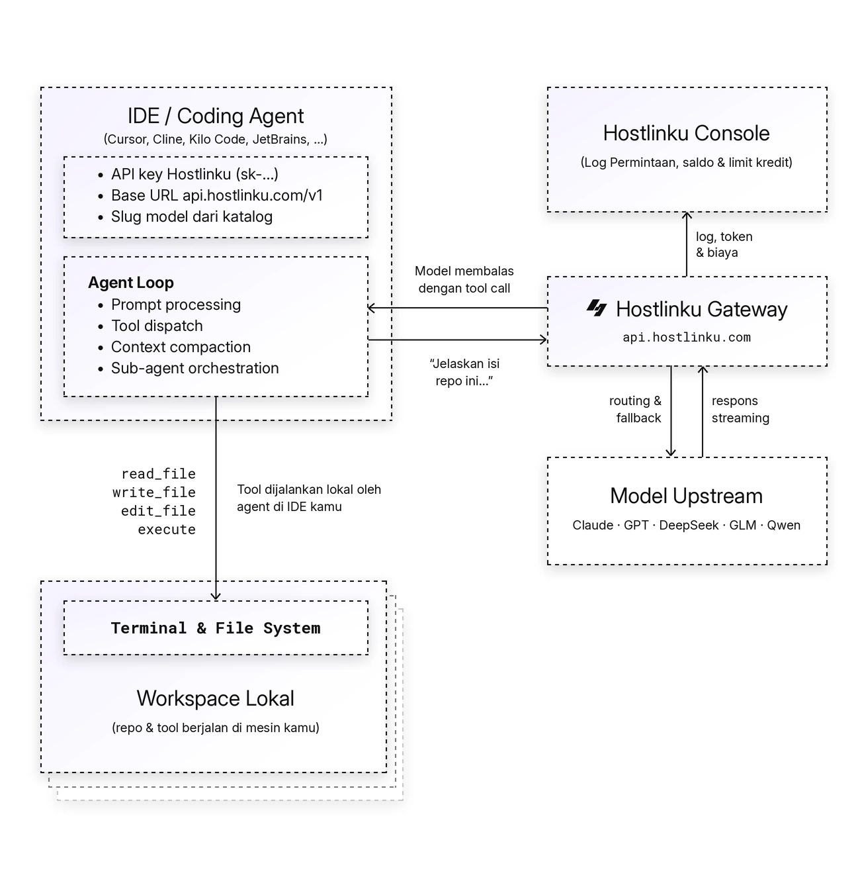

import { Callout, Steps } from "/snippets/mdx.jsx";

[OpenAI Agents SDK](https://openai.github.io/openai-agents-python/) 默认使用
**Responses API**，该接口由 Hostlinku 提供，地址为 [`POST /v1/responses`](/zh/responses)。只需
向 OpenAI 客户端提供 Hostlinku 的 `base_url`，并关闭追踪功能（追踪数据将导出至
OpenAI 平台，而非通过网关）。

<Callout type="note" title="模型和工具的兼容性">
  选择适用于服务模式 API 密钥的可用模型。对 Vision、JSON 模式、推理和工具调用的支持均遵循该模型及其协议路径。请参阅 [兼容性限制](/zh/responses)。
</Callout>

<Steps>


<a id="instal"></a>

### 安装

```bash
pip install openai-agents            # Python
npm install @openai/agents openai    # TypeScript / Node.js
```

### Python

```python
import os
from openai import AsyncOpenAI
from agents import Agent, Runner, function_tool, set_default_openai_client, set_tracing_disabled

client = AsyncOpenAI(
    base_url="https://api.hostlinku.com/v1",
    api_key=os.environ["HOSTLINKU_API_KEY"],
)
set_default_openai_client(client, use_for_tracing=False)
set_tracing_disabled(True)


@function_tool
def cuaca(kota: str) -> str:
    """Cuaca saat ini di sebuah kota."""
    return f"Cuaca di {kota}: cerah, 31°C"


agent = Agent(
    name="Asisten",
    instructions="Jawab singkat dalam bahasa Indonesia.",
    model="claude-sonnet-4-6",
    tools=[cuaca],
)

result = Runner.run_sync(agent, "Bagaimana cuaca di Jakarta hari ini?")
print(result.final_output)
```

### TypeScript

```ts
import OpenAI from "openai";
import { Agent, run, tool, setDefaultOpenAIClient, setTracingDisabled } from "@openai/agents";
import { z } from "zod";

setDefaultOpenAIClient(
  new OpenAI({ baseURL: "https://api.hostlinku.com/v1", apiKey: process.env.HOSTLINKU_API_KEY })
);
setTracingDisabled(true);

const cuaca = tool({
  name: "cuaca",
  description: "Cuaca saat ini di sebuah kota",
  parameters: z.object({ kota: z.string() }),
  execute: async ({ kota }) => `Cuaca di ${kota}: cerah, 31°C`,
});

const agent = new Agent({
  name: "Asisten",
  instructions: "Jawab singkat dalam bahasa Indonesia.",
  model: "gpt-5-5",
  tools: [cuaca],
});

const result = await run(agent, "Bagaimana cuaca di Jakarta hari ini?");
console.log(result.finalOutput);
```

<a id="verifikasi"></a>

### 验证

如果模型调用工具，此示例通常会在**请求日志**中生成两个请求：工具调用的请求和响应。

</Steps>

<a id="cara-kerja-agent-loop"></a>

## 代理循环的工作原理

代理将提示发送至网关。如果模型请求工具，SDK 会运行该工具，然后将结果发回，直至响应完成。每个模型调用在 **请求日志** 中都有独立的请求。



<a id="tanpa-mengubah-kode-environment-variable"></a>

## 无需修改代码：环境变量

OpenAI SDK 会读取 `OPENAI_BASE_URL` 和 `OPENAI_API_KEY`，因此 Agents SDK 可以重定向到
Hostlinku 而无需修改代码——只需通过环境变量关闭跟踪即可：

```bash
export OPENAI_BASE_URL=https://api.hostlinku.com/v1
export OPENAI_API_KEY=sk-your-api-key          # API key Hostlinku
export OPENAI_AGENTS_DISABLE_TRACING=1
python agent.py
```

<a id="responses-api-atau-chat-completions"></a>

<a id="是responses-api还是chat-completions"></a>

## 是“API 响应”还是“聊天自动补全”？

默认 SDK 使用 Responses API（`/v1/responses`）。推理和工具支持遵循原生/桥接模式及路径。若要使用 Chat Completions（`/v1/chat/completions`）：

```python
from agents import set_default_openai_api
set_default_openai_api("chat_completions")
```

```ts
import { setOpenAIAPI } from "@openai/agents";
setOpenAIAPI("chat_completions");
```

两者使用相同的 API 密钥、余额和请求日志。

<Callout type="important" title="无状态（Stateless）：请勿使用 previous_response_id / conversation">
  Hostlinku 不存储响应。让 `Runner`/`run` 管理历史记录（默认 SDK 会在
  每个轮次将整个历史记录发送到 `input`）。请勿设置 `previous_response_id`、
  `conversation_id` 或 `OpenAIConversationsSession`——网关会以
  `400 invalid_request_error` 状态码拒绝这些参数。本地会话（如 `SQLiteSession`）仍可使用，因为
  其历史记录存储在您这边。
</Callout>

<a id="yang-didukung-lewat-gateway"></a>

<a id="通过网关支持的"></a>

## 通过网关支持

| Agents SDK 功能 | 状态 |
|---|---|
| `function_tool` / `tool()`，并行工具调用 | 当模型支持函数调用时可用；并行工具调用遵循模型规则。 |
| 代理之间的交接（包括每个代理使用的不同模型） | 是——在同一个流程中混合使用 `claude-sonnet-4-6` 和 `gpt-5-5` |
| 结构化输出（`output_type` / Zod） | 对于支持 JSON 模式的模型，请保留“是” |
| 流式处理（`Runner.run_streamed`、`run(..., { stream: true })`） | 是 |
| `reasoning={"effort": …}` 通过 `ModelSettings` | 已接受；值和结果应遵循模型及协议路径。 |
| OpenAI 托管工具（`WebSearchTool`、`FileSearchTool`、`CodeInterpreterTool`） | 依赖于上游的原生响应；桥接聊天仅翻译 `type: "function"` 类型的工具。如果托管工具不可用，请使用自身的函数工具。 |
| 追踪至 OpenAI 平台 | 不通过网关——禁用，或使用第三方跟踪处理器 |

<a id="troubleshooting"></a>

## 故障排除

- **完整错误日志 *tracing export 401*** - 跟踪功能尚未关闭；请调用
  `set_tracing_disabled(True)` / `setTracingDisabled(true)` 或设置 `OPENAI_AGENTS_DISABLE_TRACING=1`。
- **`400 previous_response_id tidak didukung`** - 删除 `previous_response_id` /
  `conversation_id` 的用法；参见上文的说明。
- **`404 model_not_found`** - `model=` 必须是 Hostlinku 的 slug，而不是 OpenAI/Anthropic 的原始模型名称。
