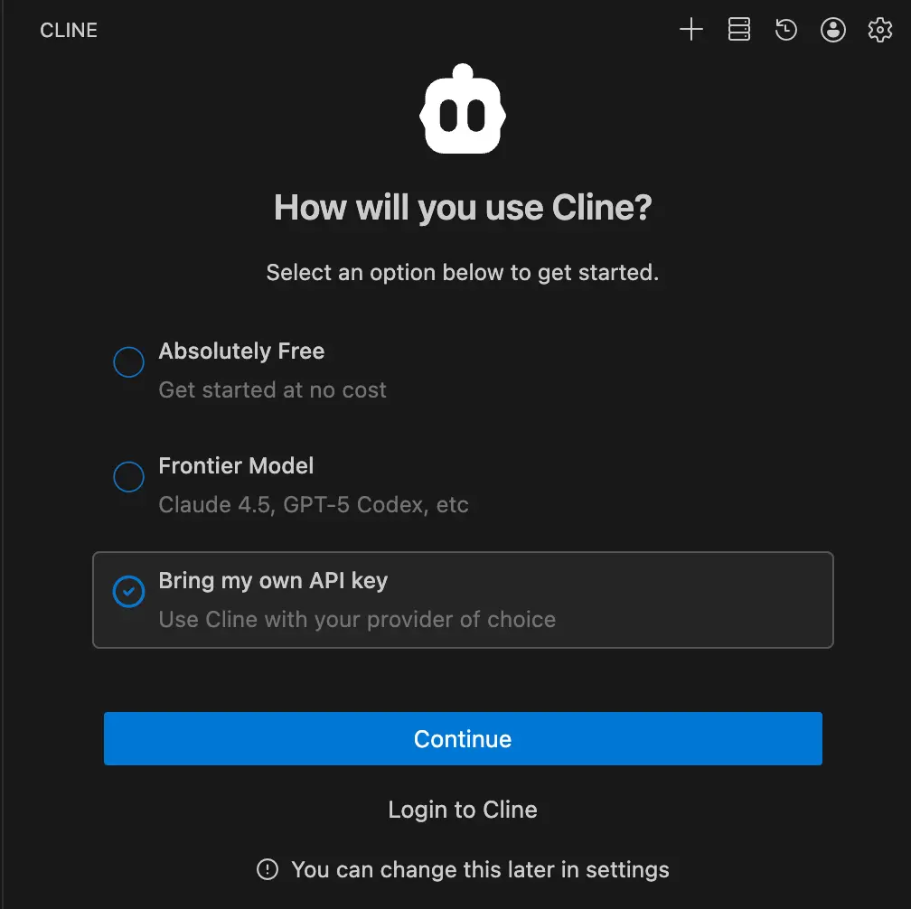
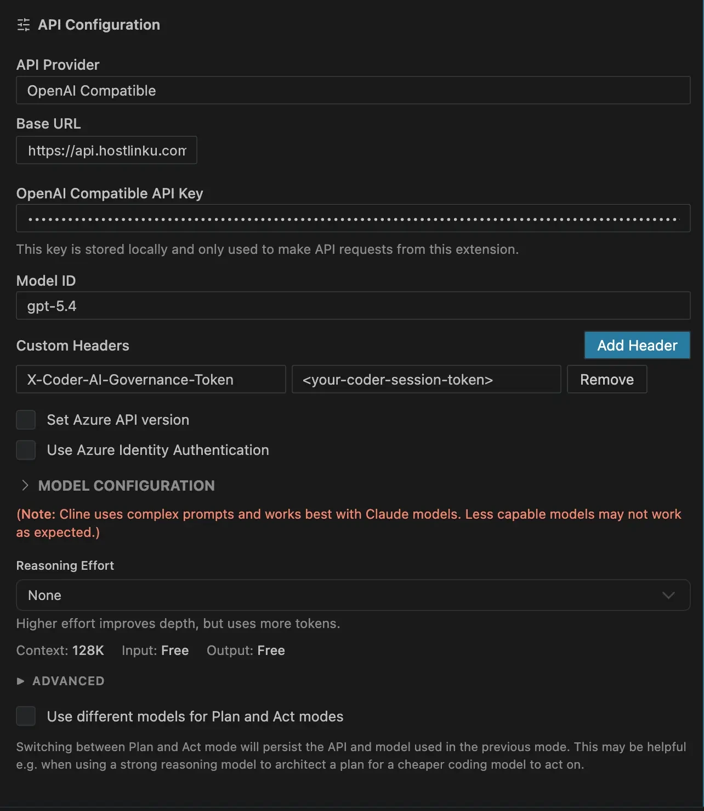
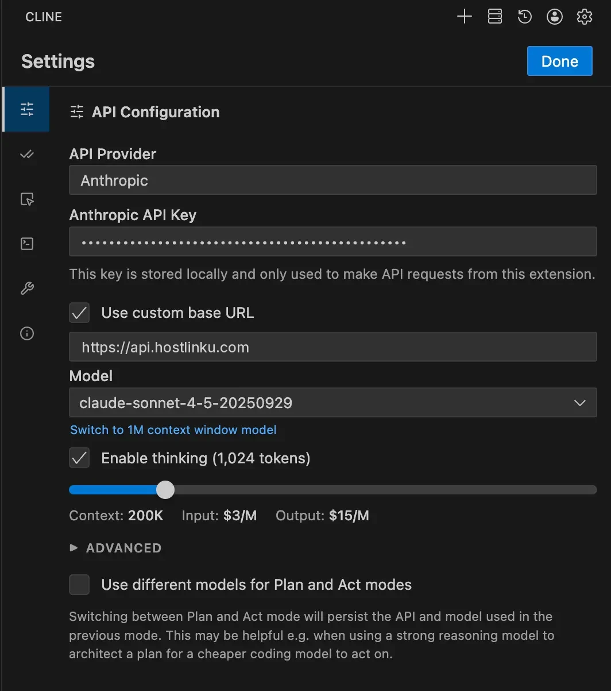

import { Callout, Steps } from "/snippets/mdx.jsx";

[Cline](https://cline.bot) — 及其分支 **Roo Code** — 提供
支持 **OpenAI Compatible** 的提供商，可接受任意基础 URL、API 密钥和模型 ID。这是
对 Hostlinku 而言是最简单的途径；通过 **Anthropic** 提供商实现的替代方案将在下文讨论。
使用 **Kilo Code**？请参阅 [Kilo Code](/zh/integrations/kilo-code) 中的专门指南。

<Steps>

<a id="buka-pengaturan-provider"></a>

<a id="打开运营商设置"></a>

### 打开提供商设置

在 Cline 面板中，点击齿轮图标（**设置**）→ **API 配置**。

首次打开 Cline 时，会显示 *How will you use Cline?* 界面——请选择 **Bring my
own API key**，然后点击 **Continue**。



<a id="pilih-openai-compatible-dan-isi"></a>

<a id="选择openai-兼容款并填写"></a>

### 选择“OpenAI Compatible”并填写

| 字段 | 值 |
|---|---|
| **API 提供商** | `OpenAI Compatible` |
| **基础 URL** | `https://api.hostlinku.com/v1` |
| **API Key** | `sk-…`（Hostlinku API密钥） |
| **模型 ID** | 来自 [目录](/zh/models) 的 slug，例如 `claude-sonnet-4-6` |

。")

<a id="disarankan-lengkapi-model-configuration"></a>

<a id="建议填写配置表单"></a>

### （建议）完善模型配置

打开**模型配置**部分，以便 Cline 正确管理上下文和价格：

- **支持图像**：针对视觉模型（`claude-sonnet-4-6`、`gpt-5-5`）请勾选此项。
- **上下文窗口大小**：来自目录的 `context_window`（例如 `1000000`）。
- **最大输出令牌数**：遵循 [目录](/zh/models) 中模型的输出限制。`64000` 仅为示例；若模型限制较低，请使用更小的数值。
- **输入/输出价格**：如需准确估算 Cline 的费用，请从 `pricing` 目录中复制相关信息；
  实际账单仍以控制台中记录的为准。



<a id="verifikasi"></a>

### 验证

点击 **Done**，提交一项小任务（*“简要说明此仓库的 README”*）。请求将显示在控制台 →
**请求日志** 中。

</Steps>

<a id="mode-plan--act-dengan-model-berbeda"></a>

<a id="计划-执行模式与不同模型"></a>

## “Plan/Act”模式采用不同的模型

Cline 可以针对 **Plan** 和 **Act** 模式使用不同的模型。常见的经济型组合：
**Plan** = `claude-opus-4-6` 或 `gpt-5-5`（推理），**Act** = `claude-sonnet-4-6` 或
`deepseek-v4-flash`（执行）。在
设置中启用 *“为 Plan 和 Act 模式使用不同的模型”*，然后使用相同的提供商配置文件填写不同的模型 ID。

<a id="alternatif-provider-anthropic"></a>

<a id="备选方案提供商-anthropic"></a>

## 备选方案：服务提供商 Anthropic

Cline 还拥有 **Anthropic** 提供商，其提供 *Use custom base URL* 选项。请填写
`https://api.hostlinku.com`（不带 `/v1`）以及您的 Hostlink API 密钥。区别在于：该
提供商上的模型列表**仅限于 Cline 识别的 ID**——请选择其 slug 与
Hostlinku目录中的 slug 完全一致的 Claude 模型（例如 `claude-sonnet-4-6`、`claude-haiku-4-5`）。对于非 Claude 模型或 slug
未在列表中的情况，请使用 **OpenAI Compatible**。



<Callout type="note" title="提示缓存">
  通过 Anthropic 路径，Cline 发送 `cache_control`，Hostlinku 将其转发——缓存令牌
  在 `cache_read_input_tokens` 中报告，并按模型缓存价格计费。通过 OpenAI
  Compatible 路径，缓存由支持该功能的模型自动处理。
</Callout>

## Cline CLI

```bash
cline auth -p openai -k "$HOSTLINKU_API_KEY" -b https://api.hostlinku.com/v1
cline --model claude-sonnet-4-6 "tambahkan validasi input di handler login"
```

<a id="troubleshooting"></a>

## 故障排除

- **`401`** - 密钥错误/已被撤销。在 Roo Code 中，请确保密钥填写在当前
  活跃的提供商**配置文件**中，而非其他配置文件。
- **`404 model_not_found`** - 模型 ID 输入错误；从 `GET /v1/models` 复制而来。
- **所有请求中的`404`** - 基础 URL 缺少 `/v1`（OpenAI 路径），或者在
  Anthropic 路径中反而使用了 `/v1`。请与上方的截图进行对比。
- **Act模式下的空响应** - 请在[目录](/zh/models)中检查该模型是否支持*调用工具*。
- **上下文即将用尽** - 请根据目录设置 *Context Window Size*，以便 Cline 能正确截断历史记录
。
