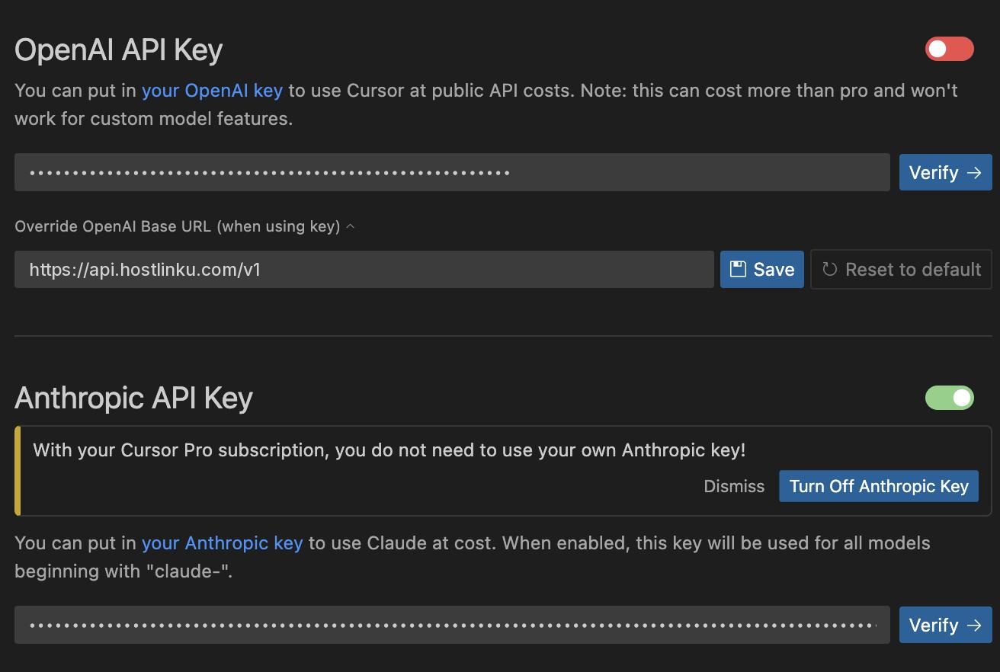

import { Callout, Steps } from "/snippets/mdx.jsx";

[Cursor](https://cursor.com) 允许通过 *Override OpenAI Base URL* 设置自定义 API 密钥。
将其指向 Hostlinku 后，聊天、Cmd-K（内联编辑）和 Agent 将使用来自
Hostlinku 目录中的模型，并从您的余额中扣除费用，而非 Cursor 的配额。

<Steps>

<a id="buka-pengaturan-model"></a>

### 打开模型设置

`Cursor Settings` (⌘/Ctrl + Shift + J) → **模型** 选项卡。

<a id="isi-api-key-dan-base-url"></a>

### 填写 API 密钥和基础 URL

在 **API Keys** 部分：

1. 启用 **OpenAI API Key** 并粘贴 Hostlinku 的 API 密钥（`sk-…`）。
2. 启用 **Override OpenAI Base URL** 并填写：

```text
https://api.hostlinku.com/v1
```



请勿在后面添加 `/chat/completions` —— Cursor 会自动添加该路径。点击
**保存**，然后在 API 密钥列旁点击 **验证**；Cursor 将向网关发送一个测试请求。

<a id="tambahkan-model-hostlinku"></a>

<a id="添加模型-hostlinku"></a>

### 添加 Hostlinku 模型

仍在 **Models** → **Add Custom Model** 选项卡中，逐一输入与
[目录](/zh/models) 中完全一致的 slug：

```text
claude-sonnet-4-6
gpt-5-5
deepseek-v4-flash
```

禁用您不想使用的内置模型，以保持模型选择列表简洁。

<a id="pilih-model-di-chat"></a>

<a id="在聊天中选择模特"></a>

### 在聊天中选择模型

在“聊天/客服”面板中，从模型下拉菜单中选择新添加的模型。第一个请求将
显示在控制台 → **请求日志** 中。

</Steps>

<a id="yang-perlu-diketahui"></a>

<a id="需知事项"></a>

## 注意事项

<Callout type="warning" title="Override 具有全局性">
  只要 **Override OpenAI Base URL** 处于启用状态，Cursor 中的所有 OpenAI 模型系列——包括
  由 Cursor 管理的模型——都会被重定向到 Hostlinku。请对所有内容使用 Hostlinku 的 slug，或者在
  覆盖开关以恢复使用 Cursor 的默认模型。
</Callout>

- **请求是从 Cursor 服务器发送的**，而不是从你的计算机发送的。因此，基础 URL 必须
  是公开的——`https://api.hostlinku.com` 符合这一要求（`localhost` 地址会被 Cursor 拒绝）。
- **Cursor Tab（自动补全）不受影响。** Tab 功能使用 Cursor 专有的基础设施，
  无法迁移至任何其他提供商。Hostlinku 支持聊天、Cmd-K 和 Agent 功能。
- **代理模式**需要 *工具调用* 和 *流式传输*。请在 [目录](/zh/models) 中检查其支持情况。如果出现 *BAD_MODEL_NAME* 错误，请检查 slug 并确保已启用 **OpenAI API 密钥** 开关。
- **连接挂起/协议错误** - 在同一设置中，将 *HTTP 兼容性
  模式* 更改为 **HTTP/1.1**。

<Callout type="tip" title="通过 OpenAI 渠道提供的 Claude 模型">
  您无需填写 *Anthropic API Key* 字段。Slug `claude-sonnet-4-6` 通过
  与 OpenAI Chat Completions 相同的路径调用；网关负责将其转换为 Anthropic 协议。
</Callout>

<a id="troubleshooting"></a>

## 故障排除

| 症状 | 解决方案 |
|---|---|
| *验证*失败 `401` | API密钥错误/已被撤销，或复制时混入了空格。 |
| *未找到模型* | Slug 拼写有误——复制自 `GET /v1/models`。 |
| 答案被截断 | 该模型的输出限制小于 Cursor 请求的限制；请尝试其他模型或不同的服务模式。 |
| 代理在处理过程中因 `429` 错误而中断 | 代理会发送多个并行请求。请参阅 [使用情况与限制](/zh/usage-and-limits)。 |
