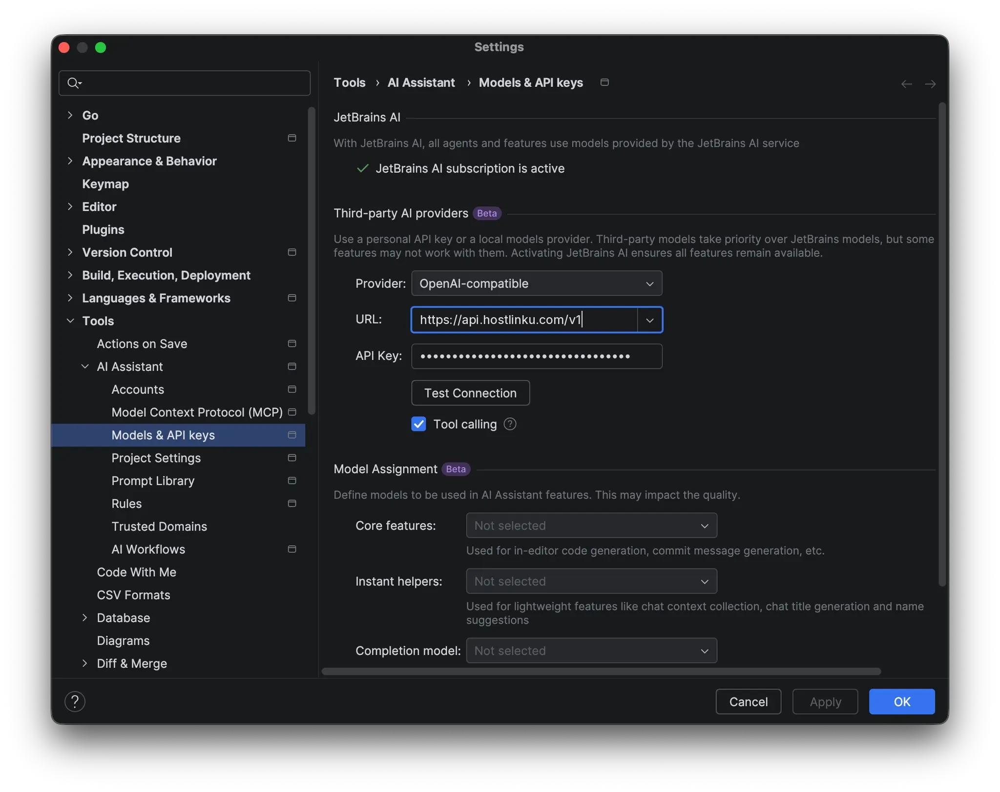
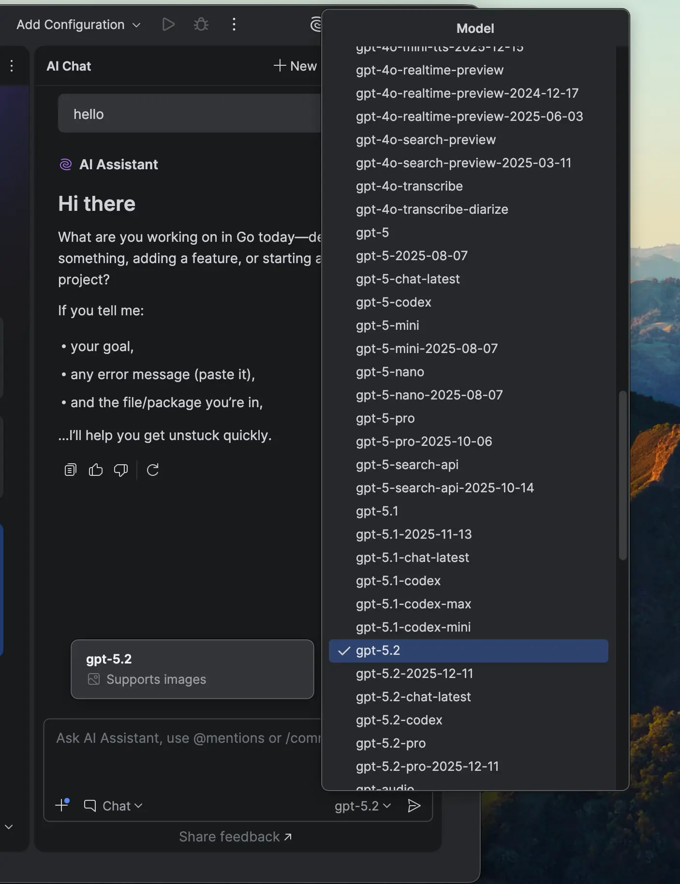

import { Callout, Steps } from "/snippets/mdx.jsx";

[JetBrains AI Assistant](https://www.jetbrains.com/help/ai-assistant/) 支持 **第三方 AI
提供商**：您可以使用自己的 API 密钥，将 AI Chat 指向任何 *OpenAI 兼容* 的端点
。 将其填入 Hostlinku 后，IntelliJ IDEA、PyCharm、WebStorm、GoLand、Rider
以及其他 JetBrains IDE 中的聊天功能将使用 Hostlinku 目录中的模型，并从您的余额中扣除费用。

**先决条件：**已安装并启用 **AI Assistant** 插件，并获取来自
[console](https://console.hostlinku.com) → **API Keys** 中的 Hostlinku API 密钥（`sk-…`）。

<Steps>

### 打开模型设置

**设置** (⌘ + , / Ctrl + Alt + S) → **工具** → **AI 助手** → **模型与 API 密钥**。

### 将 Hostlinku 添加为第三方提供商

在**第三方 AI 提供商**部分：

| 字段 | 值 |
|---|---|
| **提供商** | `OpenAI-compatible` |
| **URL** | `https://api.hostlinku.com/v1` |
| **API Key** | `sk-…`（Hostlinku API密钥） |
| **工具调用** | 已勾选 |

点击 **Test Connection**——IDE 会向网关发送测试请求。如果成功，请点击 **Apply**
然后点击 **OK**。

### （可选）设置模型分配

在 **Model Assignment** 部分，您可以为 **Core features**（例如
`claude-sonnet-4-6`）和 **Instant helpers**（例如 `claude-haiku-4-5`）选择 Hostlinku 模型。 请将**Completion model**
保留为 *Not selected* ——内联自动补全使用的是 Hostlinku 未支持的 FIM（参见
[概述](/integrations#compatibility-limits)）。

### 在 AI Chat 中选择模型

打开 **AI Chat**，确保 **Chat** 模式处于激活状态，然后从模型下拉菜单中选择模型。该列表
取自 `GET /v1/models`，因此显示的 slug 与 [目录](/zh/models) 相同。

第一个请求将显示在控制台 → **请求日志** 中。

</Steps>

## 注意事项

<Callout type="note" title="仅限 OpenAI 兼容路径">
  AI Assistant 目前仅支持 *OpenAI-compatible* 的第三方提供商——尚无
  Anthropic 基础 URL 选项。Claude 模型仍可使用：通过
  Chat Completions 和将协议转换为 Anthropic 协议的网关调用 slug `claude-sonnet-4-6`。
</Callout>

- **Base URL 必须以 `/v1` 结尾。** IDE 会自行添加 `/models` 和 `/chat/completions`；
  若缺少 `/v1`，*Test Connection* 将因 `404` 错误而失败。
- **没有自定义标头。** AI Assistant 仅将 API 密钥作为
  `Authorization: Bearer sk-…` 发送——这对 Hostlinku 来说已经足够了。
- **IDE 中的工具调用**需要支持该功能的模型。请检查 [目录](/zh/models)，并在模型设置中勾选 **工具调用**。
- **JetBrains 中的 Claude Code** 是一个独立的集成（Claude Code 插件使用其 CLI）。请参阅
  [Claude Code](/zh/integrations/claude-code)。

## 故障排除

| 症状 | 解决方案 |
|---|---|
| *测试连接* 失败 `401` | API密钥错误/已被撤销，或复制时混入了空格。 |
| *测试连接* 失败 `404` | URL 不以 `/v1` 结尾，或包含额外路径，例如 `/chat/completions`。 |
| 下拉菜单为空 | 连接尚未“应用”，或者 API 密钥无法访问其服务模式下的任何模型。 |
| 聊天因 `429` 错误而中断 | 并行请求过多。请参阅 [使用情况与限制](/zh/usage-and-limits)。 |
