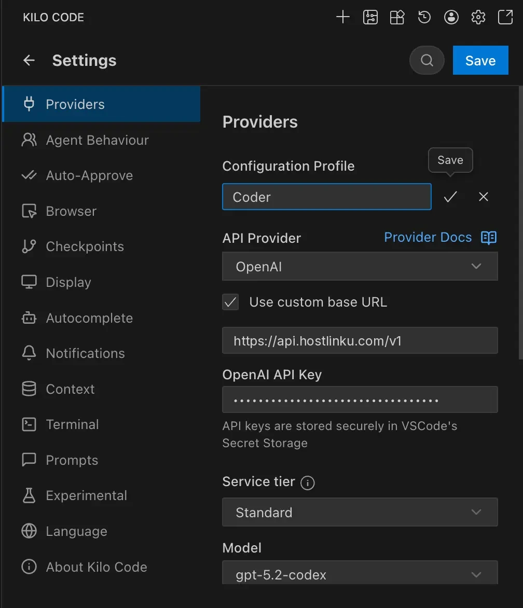
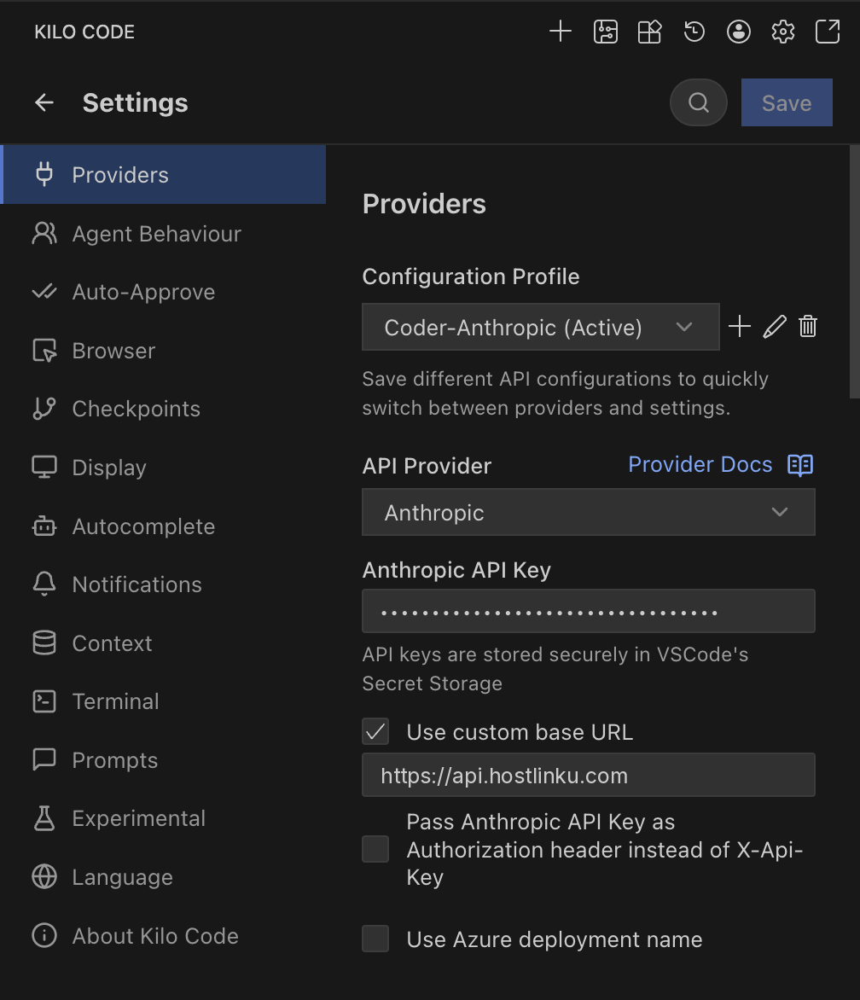

import { Callout, Steps } from "/snippets/mdx.jsx";

[Kilo Code](https://kilocode.ai) —— 适用于 VS Code 和 JetBrains 的编码代理扩展（源自
Cline/Roo Code）——按**配置文件**存储提供商设置。您可以创建
独立于其他配置文件的Hostlinku配置文件，并一键切换。

**先决条件：**已安装 Kilo Code 扩展，并获取来自
[console](https://console.hostlinku.com) → **API Keys** 中的 Hostlinku API 密钥（`sk-…`）。

<Steps>

### 创建个人资料

打开 Kilo Code 面板 → 齿轮图标（**Settings**）→ **Providers**。在 **Configuration Profile** 中，
点击 **+** 并为配置文件命名（例如 `Hostlinku`）。

### 提供商和基础 URL 的内容

| 字段 | 值 |
|---|---|
| **API 提供商** | `OpenAI` |
| **使用自定义基础 URL** | 已勾选 |
| **基础 URL** | `https://api.hostlinku.com/v1` |
| **OpenAI API 密钥** | `sk-…`（Hostlinku API密钥） |
| **模型** | 来自 [目录](/zh/models) 的 slug，例如 `gpt-5-5` |

提供商 `OpenAI` 仅显示 Kilo Code 已知的模型。对于其他 slug（如 Claude、
DeepSeek、GLM、Kimi、Qwen），请选择 **OpenAI Compatible**——其基础 URL 和 API 密钥相同，然后在 **Model ID** 中输入
相应的 slug。

### 保存并测试

点击**“保存”**，然后提交一个小任务（*“简要说明此仓库的 README”*）。请求将显示在控制台
→ **请求日志**中。

</Steps>

## 备选方案：服务提供商 Anthropic

选择 **API 提供商** `Anthropic`，勾选 **使用自定义基础 URL**，填写 `https://api.hostlinku.com`
（**不带** `/v1`），并将 Hostlinku 的 API 密钥粘贴到 **Anthropic API 密钥** 字段中。 可用模型仅限于
Kilo Code 所知的 Claude 模型——请选择其 slug 与 Hostlinku 目录中完全一致的模型
（例如 `claude-sonnet-4-6`、`claude-haiku-4-5`）。

<Callout type="note" title="提示缓存">
  通过 Anthropic 通道，Kilo Code 发送 `cache_control`，Hostlinku 将其转发——缓存令牌
  会在 `cache_read_input_tokens` 中报告，并按模型缓存价格计费。参见
  [提示缓存](/zh/prompt-caching)。
</Callout>

## 注意事项

- **每种模式一个配置文件。** Kilo Code 可以为 *Architect*、*Code*
  和 *Debug* 模式使用不同的配置文件。简明示例：Architect = `claude-opus-4-6`，Code = `claude-sonnet-4-6`。
- **无需自定义头部。** Hostlinku 只需使用 API 密钥；请将自定义
  头部部分留空。
- **内联自动补全** Kilo Code 使用 Hostlinku 未支持的 FIM 端点——请保留
  该功能在默认提供商中（参见 [概述](/integrations#compatibility-limits)）。

## 故障排除

| 症状 | 解决方案 |
|---|---|
| `401` | 密钥错误/已被撤销，或在其他配置文件中已填写——请确保**Hostlinku**配置文件处于活动状态。 |
| 所有请求中的 `404` | Base URL 缺少 `/v1`（OpenAI 路径），或者在 Anthropic 路径中反而使用了 `/v1`。请参考上方的截图。 |
| `404 model_not_found` | Model ID 拼写有误；请从 `GET /v1/models` 处复制。 |
| 下拉菜单中不存在 Claude/DeepSeek 模型 | 提供商 `OpenAI` 仅显示 OpenAI 模型——请使用 **OpenAI Compatible**。 |
| 代理在未调用工具的情况下停止运行 | 请检查 [目录](/zh/models) 中各模型对 *tool calling* 的支持情况。 |
