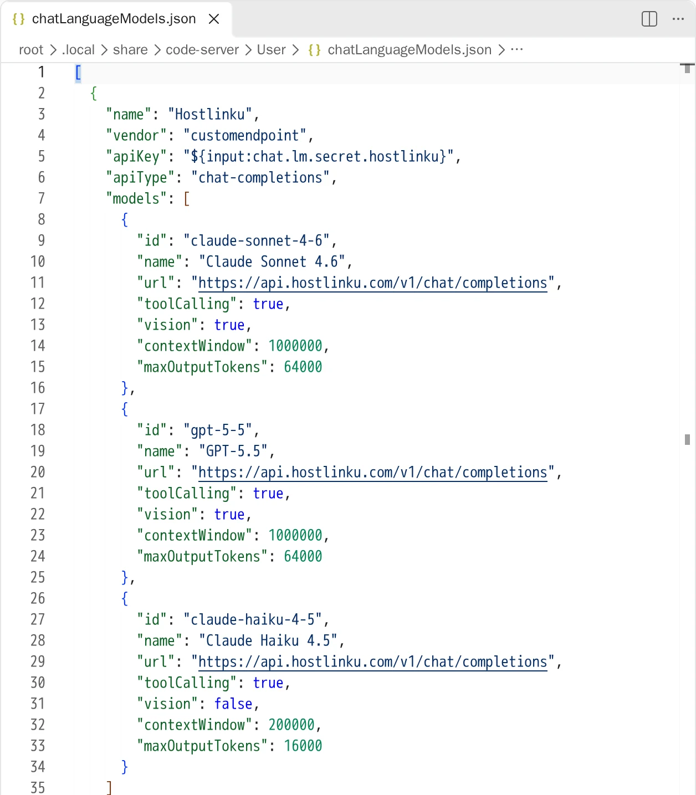
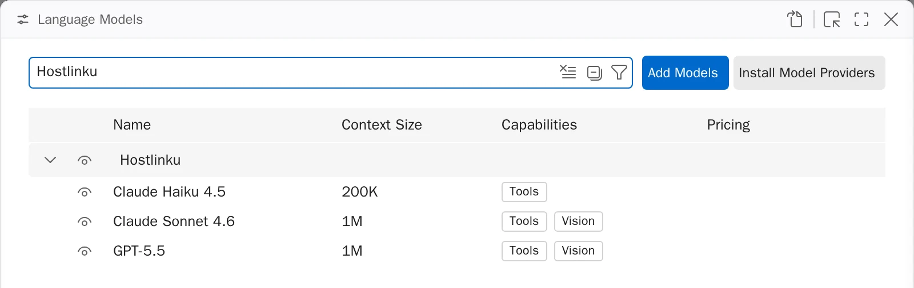
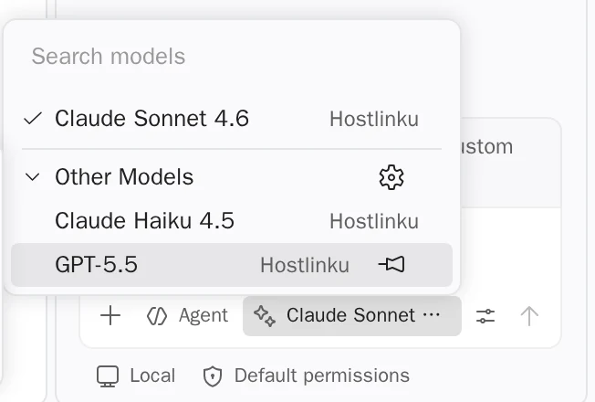

import { Callout, Steps } from "/snippets/mdx.jsx";

[VS Code](https://code.visualstudio.com/docs/agent-customization/language-models) 内置聊天功能
（聊天面板、Agent 模式和内联聊天）可通过 **Custom
Endpoint** 提供商调用外部模型。该提供商支持三种 API 格式——Chat Completions、Responses 和 Anthropic
Messages——这三种格式均由 Hostlinku 提供支持。此类 BYOK 模型**无需登录 GitHub
或安装 Copilot 插件**。

**先决条件：** 最新版本的 VS Code（自定义端点已取代已弃用的 *OpenAI Compatible*
提供商）以及扩展
[GitHub Copilot Chat](https://marketplace.visualstudio.com/items?itemName=GitHub.copilot-chat)。

<Steps>

<a id="tambahkan-provider-custom-endpoint"></a>

### 添加自定义端点提供商

打开命令面板（⌘/Ctrl + Shift + P）→ **Chat: Manage Language Models** → **Add Models** →
**Custom Endpoint**。然后填写：

| 提示 | 值 |
|---|---|
| **组名** | `Hostlinku` |
| **显示名称** | `Hostlinku` |
| **API密钥** | `sk-…`（Hostlinku API密钥） |
| **API 类型** | **Chat Completions** |

VS Code 将 API 密钥存储在密钥存储中，并将引用
(`${input:chat.lm.secret.…}`) 写入 `chatLanguageModels.json`。**请勿**将原始密钥粘贴到
JSON 文件中。

<a id="daftarkan-model-hostlinku"></a>

<a id="注册模型-hostlinku"></a>

### 列出 Hostlinku 模型

VS Code 打开 `chatLanguageModels.json`。将 `models` 数组填充为
[目录](/zh/models) 中的 slug——保留 VS Code 生成的 `apiKey` 值：

```json
[
  {
    "name": "Hostlinku",
    "vendor": "customendpoint",
    "apiKey": "${input:chat.lm.secret.XXXXX}",
    "apiType": "chat-completions",
    "models": [
      {
        "id": "claude-sonnet-4-6",
        "name": "Claude Sonnet 4.6",
        "url": "https://api.hostlinku.com/v1/chat/completions",
        "toolCalling": true,
        "vision": true,
        "contextWindow": 1000000,
        "maxOutputTokens": 64000
      },
      {
        "id": "gpt-5-5",
        "name": "GPT-5.5",
        "url": "https://api.hostlinku.com/v1/chat/completions",
        "toolCalling": true,
        "vision": true,
        "contextWindow": 1000000,
        "maxOutputTokens": 64000
      },
      {
        "id": "claude-haiku-4-5",
        "name": "Claude Haiku 4.5",
        "url": "https://api.hostlinku.com/v1/chat/completions",
        "toolCalling": true,
        "vision": false,
        "contextWindow": 200000,
        "maxOutputTokens": 16000
      }
    ]
  }
]
```

上文中的 `contextWindow` 和 `maxOutputTokens` 是 VS Code 的本地限制示例。请根据 [目录](/zh/models) 中的模型页面进行调整；较小的数值会限制工具中的使用。



请将 `url` **连同端点路径**（`/v1/chat/completions`）完整写出，以免 VS Code 需要
进行推测。`toolCalling: true` 是必需的，以便模型在 **Agent** 模式下显示。

<a id="pilih-model-di-chat"></a>

### 在聊天中选择模型

保存文件。Hostlinku 模型出现在 **Chat：管理语言模型** 中，并附有其
上下文大小和功能：



然后从“聊天”面板中的模型选择器中选择模型（如果未显示，请重启 VS Code）。第一个请求
会显示在控制台 → **请求日志** 中。



</Steps>

<a id="format-api-lain"></a>

## 其他 API 格式

每个模型可通过其各自的 `apiType` 使用不同的格式：

| `apiType` | `url` | 注释 |
|---|---|---|
| `chat-completions` | `https://api.hostlinku.com/v1/chat/completions` | 建议的默认设置——所有目录模型。 |
| `messages` | `https://api.hostlinku.com/v1/messages` | Anthropic 格式；VS Code 将密钥作为 `x-api-key` 发送（网关接受此格式）。 |
| `responses` | `https://api.hostlinku.com/v1/responses` | **必须**添加 `"statefulResponses": false` ——详见下文。 |

<Callout type="important" title="Hostlinku API 的响应是无状态的">
  默认情况下，VS Code 会为 `apiType: "responses"` 的模型发送 `previous_response_id`，
  而 Hostlinku 不存储响应，因此此类请求将被 `400` 拒绝。如果
  希望使用 Responses API，请在该模型中添加 `"statefulResponses": false`，以便 VS
  Code 发送完整的对话历史记录。请参阅 [Responses API](/zh/responses)。
</Callout>

```json
{
  "id": "gpt-5-5",
  "name": "GPT-5.5 (Responses)",
  "url": "https://api.hostlinku.com/v1/responses",
  "apiType": "responses",
  "statefulResponses": false,
  "toolCalling": true,
  "vision": true,
  "contextWindow": 1000000,
  "maxOutputTokens": 64000
}
```

<a id="yang-perlu-diketahui"></a>

<a id="需知事项"></a>

## 注意事项

- **内联建议（自动补全）仍使用 Copilot。** BYOK 仅适用于聊天和
  实用任务；语义搜索、嵌入和代码补全需要 GitHub 账户。
- **无需登录 GitHub**，VS Code 会要求你选择 *实用模型*（会话标题、提交信息、
  等）。 请将 `chat.utilityModel` 和 `chat.utilitySmallModel` 的设置填入 Hostlinku 模型——
  `claude-haiku-4-5` 适用于 *small* 模型。
- **Copilot Business/Enterprise：** 组织管理员需在 Copilot GitHub 设置中启用 *Bring Your Own
  Language Model Key in VS Code* 策略。
- **不受信任的工作区**（受限模式）仅显示 **Auto** 模型；请信任
  该工作区，以便显示 Hostlinku 模型。

<a id="troubleshooting"></a>

## 故障排除

| 症状 | 解决方案 |
|---|---|
| “Model”在 Agent 模式中未出现 | 设置 `"toolCalling": true`，并使用目录中带有 *tool calling* 的模型。 |
| `401` | API密钥错误/已撤销——请通过语言模型编辑器中的提供商齿轮图标进行更新。 |
| `404 model_not_found` | `id` 必须与 `GET /v1/models` 中的 slug 完全一致。 |
| `400` 指 `previous_response_id` | 具有 `apiType: "responses"` 且不包含 `"statefulResponses": false` 的模型。 |
| 新模型未显示 | 保存 `chatLanguageModels.json` 后，请重启 VS Code。 |
